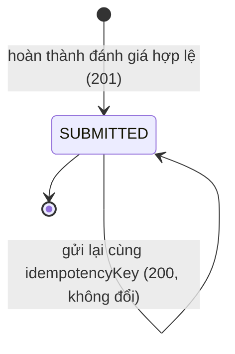
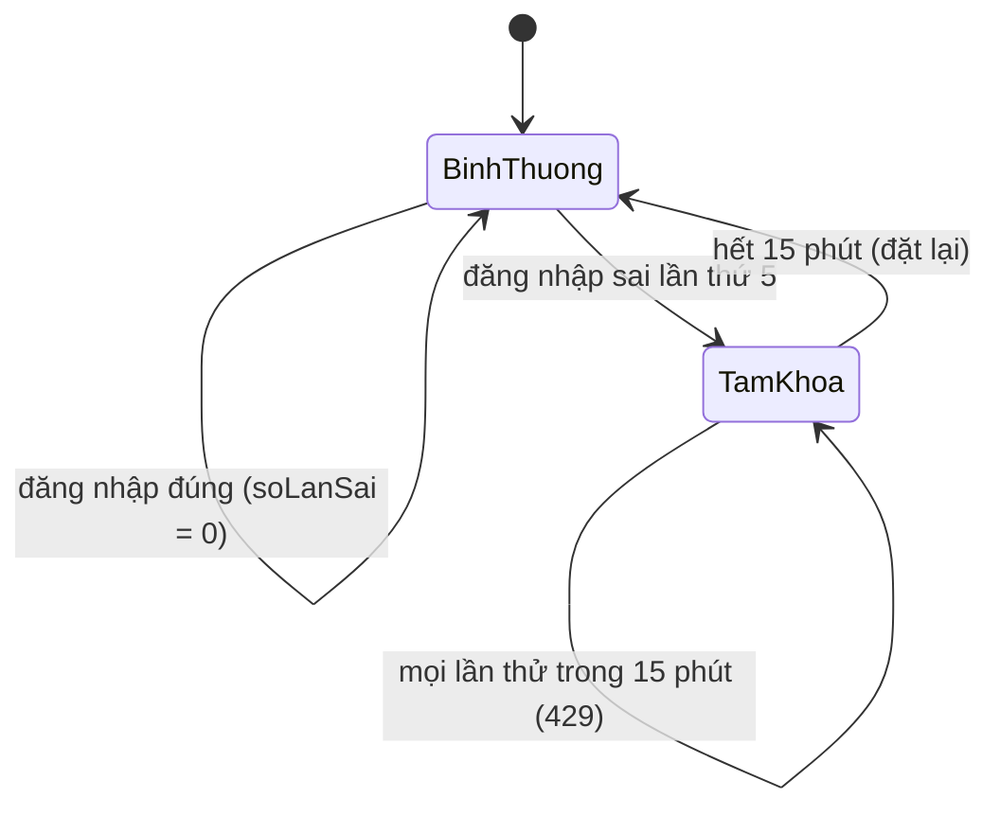
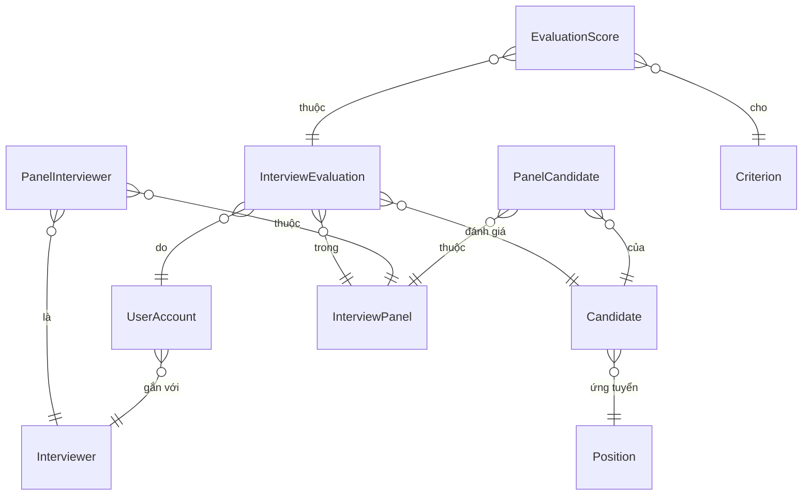

# Đặc tả chức năng — U1 scoring-skeleton

Walking skeleton = lát cắt mỏng chạy xuyên suốt từ dữ liệu đến màn hình. U1 chứng minh backend Node.js, Oracle XE và app Flutter nối được với nhau: nạp dữ liệu, đăng nhập, chọn HĐPV, mở danh sách ứng viên, chấm điểm từng tiêu chí, hoàn thành đánh giá và lưu vào Oracle. Tài liệu này là nguồn chính thức cho luồng xử lý và trạng thái; các view dẫn xuất (sơ đồ thực thể, tóm tắt quy tắc) lấy từ `entities.md` và `rules.md`.

## Sources

- `inception/units-generation/unit-of-work.md` — phạm vi, ranh giới, ràng buộc của U1
- `inception/units-generation/unit-of-work-story-map.md` — 9 story của U1
- `inception/requirements-analysis/requirements.md` — FR-A0..FR-A7, BR-A1, BR-A2
- `inception/domain-design/components.md` — IdentityAccess, InterviewCatalog, Evaluation, DataImport, InterviewerApp
- `inception/contract-design/contract-summary.md` — C1 (API), C2 (chính sách truy cập), C3 (xác thực), C5, C6
- `construction/u1-scoring-skeleton/functional-design/entities.md`, `rules.md`
- `construction/u1-scoring-skeleton/functional-design/functional-design-questions.md` — Q1 = B, Q2..Q6 = A

## Phạm vi U1 và điều chỉnh hợp đồng

- Trong phạm vi: US7.2, US7.1, US7.3, US1.1, US2.1, US4.1, US5.1, US5.2, US6.1 và màn S1..S4.
- Ngoài phạm vi (làm ở Unit khác): kết luận, refer, điểm trung bình (U2); xem lại bài, gửi lại khi mất mạng, đăng xuất (U2); CV (U3); AI (U4); giao diện chung nâng cao (U5).
- Điều chỉnh hợp đồng (cập nhật trong `contract-summary.md`): `GET /panels/{maHdpv}/my-evaluations` do U1 cung cấp dạng tối thiểu (`maUngVien`, `submittedAt`) để nhãn Đã chấm hoạt động ngay trong skeleton; U2 chỉ thêm `ketLuan`, `diemTrungBinh` (chỉ thêm, không đổi). `POST /auth/login` thêm phản hồi `429` (`LOGIN_LOCKED`).
- Không có API backend nào ngoài danh sách C1 của U1: `POST /auth/login`, `GET /panels`, `GET /panels/{maHdpv}/candidates`, `GET /panels/{maHdpv}/candidates/{maUngVien}`, `GET /criteria`, `POST /panels/{maHdpv}/candidates/{maUngVien}/evaluation`, `GET /panels/{maHdpv}/my-evaluations`.

## Quy trình

### WF-1 Nạp dữ liệu (người vận hành)

1. Người vận hành chạy lệnh nạp với tệp JSON theo C6. Lệnh mở một giao dịch Oracle.
2. Nạp theo thứ tự: tiêu chí → vị trí → CBQL → tài khoản → ứng viên → HĐPV → chi tiết HĐPV – ứng viên → chi tiết HĐPV – CBQL (BR4.1).
3. Mỗi bản ghi được kiểm tra: trường bắt buộc, khóa tham chiếu (BR4.2), trạng thái HĐPV (BR4.3), giờ (BR4.4), thang tiêu chí (BR4.7), mật khẩu tối thiểu 8 ký tự (BR4.8). Bản ghi lỗi bị bỏ qua, ghi vào báo cáo kèm số dòng và lý do.
4. Bản ghi hợp lệ: trùng mã thì cập nhật, ngược lại thêm mới (BR4.1); không xóa bản ghi vắng trong tệp (BR4.9). Mật khẩu được băm bcrypt khi ghi (BR1.5).
5. Mất kết nối giữa chừng: hoàn tác và thoát mã lỗi khác 0 (BR4.5). Thành công: commit và in báo cáo thêm / cập nhật / lỗi theo nhóm (BR4.6).

### WF-2 Đăng nhập

1. Người dùng nhập email và mật khẩu ở S1. App kiểm tra định dạng và chặn nếu sai (BR1.3).
2. App gọi `POST /auth/login`. Server chuẩn hóa email và tra `LoginThrottle`.
3. Nếu `khoaDen` còn hiệu lực: trả `429` `LOGIN_LOCKED` kèm `Retry-After` (BR1.6).
4. Nếu không có tài khoản hoặc mật khẩu sai: tăng `soLanSai`; đạt 5 thì đặt `khoaDen` = bây giờ + 15 phút; trả `401` thông báo chung (BR1.1).
5. Nếu mật khẩu đúng nhưng tài khoản LOCKED: `403` (BR1.2).
6. Nếu đúng và ACTIVE: đặt lại `soLanSai`; phát JWT hạn 8 giờ, trả `200` với token, expiresAt, user (BR1.4, BR1.7). App lưu token an toàn và chuyển sang S2.
7. Làm mới trang web khi token còn hạn thì giữ đăng nhập; token hết hạn hoặc `401` ở bất kỳ API nào thì xóa token và về S1 (BR1.4).

### WF-3 Chọn HĐPV

1. S2 gọi `GET /panels`. Server lấy HĐPV có `PanelInterviewer.maCbql` = `employedId` của người gọi và `trangThai` = Inprogress (BR2.1, BR2.2), sắp theo ngày rồi mã (BR2.4).
2. Mỗi dòng hiển thị mã, tên, ngày, hình thức, địa điểm và `soUngVienXacNhan` (BR2.8).
3. Rỗng: "Bạn chưa được gán vào hội đồng phỏng vấn nào đang diễn ra"; lỗi mạng: thông báo và nút Thử lại (BR2.9).
4. Gọi trực tiếp một HĐPV không được gán trả `403`; được gán nhưng không Inprogress trả `404` (BR2.1, BR2.2, BR2.10).

### WF-4 Danh sách ứng viên

1. S3 gọi đồng thời `GET /panels/{maHdpv}/candidates` và `GET /panels/{maHdpv}/my-evaluations`, ghép theo `maUngVien` (BR2.11, ADR-002).
2. Server trả ứng viên có `xacNhan` = Y của mọi vị trí, sắp theo `tuThoiGian` rồi `maUngVien`; mỗi dòng có vị trí riêng và khung giờ (BR2.3, BR2.5, BR2.7). Không trả sdt, ngaySinh, gioiTinh (BR2.6).
3. App hiển thị Đã chấm khi có trong `my-evaluations`, ngược lại Chưa chấm.
4. HĐPV không tồn tại: `404`; không được gán: `403`; không Inprogress: `404` (BR2.10, BR2.1, BR2.2). Rỗng: "Chưa có ứng viên xác nhận lịch" (BR2.9).

### WF-5 Mở phiếu chấm

1. S4 gọi `GET /panels/{maHdpv}/candidates/{maUngVien}` và `GET /criteria`. Ứng viên `xacNhan` = N hoặc HĐPV không Inprogress trả `404` (BR2.2, BR2.3).
2. App hiển thị thông tin cho phép (BR3.11) và các tiêu chí ACTIVE theo `thuTu` (BR3.1). Không có tiêu chí: báo "Chưa cấu hình tiêu chí" và khóa chấm.
3. Nút Hoàn thành đánh giá khóa cho tới khi mọi tiêu chí có điểm; bấm vào nút khóa thì đánh dấu và chuyển tiêu điểm tới tiêu chí thiếu đầu tiên (BR3.3, BR3.10). Ở U1 điều kiện mở khóa chỉ gồm điểm đủ (kết luận bắt buộc thêm ở U2).
4. Ứng viên đã Đã chấm thì S4 mở ở dạng chỉ đọc với điểm và nhận xét đã lưu (đọc qua kết quả hoàn thành vừa có; xem lại sau này thuộc U2).

### WF-6 Hoàn thành đánh giá

1. Người dùng chọn điểm 1..5 theo thang từng tiêu chí (BR3.2), nhập nhận xét tùy chọn tối đa 2000 ký tự (BR3.4).
2. Bấm Hoàn thành đánh giá, xác nhận hộp thoại "Sau khi hoàn thành sẽ không sửa được" (BR3.10). App sinh `idempotencyKey` (UUID) một lần cho phiếu này.
3. App gọi `POST /panels/{maHdpv}/candidates/{maUngVien}/evaluation` với `idempotencyKey`, `diem[]`, `nhanXet`.
4. Server theo thứ tự: xác thực token (BR1.4) → chính sách `canComplete` (BR2.1, BR3.5) → kiểm payload (BR3.2, BR3.3, BR3.4, 400 nếu sai) → tra `idempotencyKey` đã dùng (BR3.7: cùng cặp HĐPV – ứng viên thì trả 200 bản cũ; khác cặp thì 409) → kiểm phiếu đã có của tôi cho cặp này (BR3.6, 409) → ghi phiếu và dòng điểm trong một giao dịch (BR3.9, 201).
5. Hai request đồng thời cho cùng cặp: ràng buộc duy nhất ở DB cho đúng một request thành công; request còn lại nhận `409` hoặc `200` tùy khóa.
6. App nhận `201`: chuyển S4 sang chỉ đọc, thông báo "Đã hoàn thành đánh giá" 3 giây, quay lại S3 thấy Đã chấm (BR3.10). Không có API sửa hoặc xóa (BR3.8).

## Máy trạng thái

### Phiếu đánh giá

Không có DRAFT ở server (Q2 = A). SUBMITTED là trạng thái cuối, không sửa, không xóa (BR3.8).

### Tạm khóa đăng nhập theo email

### Tài khoản

ACTIVE ⇄ LOCKED chỉ đổi qua dữ liệu nạp (BR4.8); đăng nhập không tự khóa tài khoản, chỉ tạm khóa theo email (BR1.6).

## Màn hình S1..S4 (U1)

| Màn | Nội dung | Trạng thái giao diện |
|---|---|---|
| S1 Đăng nhập | Email, mật khẩu, nút hiện/ẩn mật khẩu, nút đăng nhập | Đang tải; lỗi chung `401`; tài khoản khóa `403`; tạm khóa `429` "Đăng nhập tạm khóa, thử lại sau 15 phút"; lỗi từng trường |
| S2 Danh sách HĐPV | Danh sách HĐPV Inprogress của tôi, tên người dùng | Đang tải; rỗng; lỗi + Thử lại |
| S3 Danh sách ứng viên | Mã, tên, vị trí, khung giờ, nhãn Đã chấm / Chưa chấm | Đang tải; rỗng; lỗi + Thử lại |
| S4 Chấm điểm | Thông tin ứng viên, tiêu chí với bộ chọn điểm, nhận xét có bộ đếm, nút Hoàn thành đánh giá | Nút khóa khi thiếu điểm; hộp thoại xác nhận; cảnh báo rời màn khi đã nhập; chỉ đọc sau khi hoàn thành |

Mockup đã duyệt (`inception/refined-mockups/`) là nguồn bố cục; giao diện U1 ở mức dùng được, chủ đề chung nâng cao thuộc U5. Phím mũi tên đổi điểm và cảnh báo hai khung thuộc U5 và U2.

## Dữ liệu mẫu cho demo và lệnh xác minh (Q6 = A)

- 5 tiêu chí thang 1..5, 3 vị trí, 3 CBQL có tài khoản (mật khẩu mẫu tối thiểu 8 ký tự, chỉ nằm trong tệp mẫu).
- 5 HĐPV, mỗi trạng thái một HĐPV: `Draft`, `Sent`, `Xác nhận`, `Inprogress`, `Completed`; một CBQL được gán cả HĐPV `Inprogress` và `Completed`, một CBQL chỉ được gán HĐPV `Draft`.
- Khoảng 6 ứng viên, trong đó 1 người `Xác nhận = N`, và HĐPV `Inprogress` có 2 ứng viên thuộc 2 vị trí khác nhau, giờ không theo thứ tự mã để kiểm sắp xếp, hai người cùng giờ để kiểm thứ tự theo mã.
- Lệnh xác minh đầu cuối `npm --prefix backend run verify:e2e` (đã được duyệt) chạy: khởi động Oracle XE, nạp dữ liệu mẫu, đăng nhập, lấy danh sách HĐPV và ứng viên, chấm đủ tiêu chí và hoàn thành một ứng viên, gửi lại cùng khóa (200), gửi khóa mới (409), rồi kiểm tra DB có đúng một phiếu SUBMITTED và đúng số dòng điểm.

## Sơ đồ thực thể (dẫn xuất từ entities.md)

Văn bản thay thế: tài khoản gắn với CBQL; ứng viên thuộc một vị trí; dòng lịch nối HĐPV với ứng viên và CBQL; phiếu đánh giá nối tài khoản, HĐPV và ứng viên; mỗi phiếu có nhiều dòng điểm, mỗi dòng cho một tiêu chí. `LoginThrottle` độc lập, khóa theo email.

## Tóm tắt quy tắc (dẫn xuất từ rules.md)

| Nhóm | Điểm chính |
|---|---|
| Đăng nhập | Thông báo chung khi sai; khóa tài khoản `403`; tạm khóa email 15 phút sau 5 lần sai (`429`); JWT 8 giờ; bcrypt |
| Truy cập | Được gán (`403`), Inprogress (`404`), `Xác nhận = Y` (`404`); không trả sdt, ngày sinh, giới tính |
| Chấm điểm | Điểm nguyên trong thang; đủ mọi tiêu chí; nhận xét ≤ 2000 ký tự |
| Hoàn thành | Một phiếu cho mỗi (người chấm, HĐPV, ứng viên); `idempotencyKey`; một giao dịch; không sửa, không xóa |
| Nạp | Thứ tự cố định, một giao dịch, chạy lại không nhân đôi, báo cáo lỗi theo dòng, không xóa |

## Kịch bản nghiệp vụ và trường hợp biên

| # | Tình huống | Kết quả |
|---|---|---|
| S-1 | Bấm Hoàn thành đánh giá hai lần liên tiếp cùng lúc | Chỉ một request chạy nhờ nút bị vô hiệu ở app; nếu hai request vẫn tới server cùng khóa thì một ghi, một trả bản đã lưu |
| S-2 | Hai thiết bị cùng đăng nhập một tài khoản, cùng hoàn thành cho một ứng viên | Một thành công `201`; thiết bị còn lại nhận `409` |
| S-3 | HĐPV chuyển sang `Completed` khi người dùng đang chấm | Vẫn hoàn thành được (BR3.5); mở bài mới thì `404` |
| S-4 | Tiêu chí bị đặt `INACTIVE` khi người dùng đang chấm | Gửi điểm của tiêu chí đó nhận `400`; app tải lại tiêu chí |
| S-5 | Ứng viên đổi thành `Xác nhận = N` khi đang chấm | Hoàn thành nhận `404`; không tạo phiếu |
| S-6 | Token hết hạn giữa lúc chấm | `401`, về S1; dữ liệu chưa hoàn thành mất (không lưu nháp, Q2 = A) |
| S-7 | Tệp nạp có hai dòng cùng mã ứng viên | Dòng sau cập nhật dòng trước; báo cáo ghi một lần cập nhật |
| S-8 | Đăng nhập sai với email chưa từng có | Vẫn đếm và có thể tạm khóa như email có thật, nên không lộ email tồn tại |

## Assumptions & Open Questions

- **[assumption]** Ứng viên đã Đã chấm mở lại ở S4 dạng chỉ đọc bằng dữ liệu của lần hoàn thành vừa xong trong phiên; sau khi tải lại, màn xem lại đầy đủ thuộc U2 (US6.3).
- **[assumption]** Đếm "đã chấm / tổng" ở S2 (AC2.1.3) thuộc U2; U1 chỉ hiển thị tổng.
- **[assumption]** Khóa tạm thời theo email không theo IP; người dùng khác nhập sai 5 lần có thể khóa nhầm một email thật trong 15 phút (đánh đổi chấp nhận được cho MVP, ghi nhận để NFR xem lại).
- **Open question:** None.
