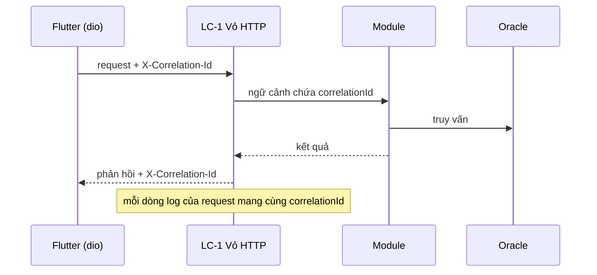

# Thiết kế quan sát — U1 scoring-skeleton

Mã `OD-n` là giải pháp quan sát.

## Sources

- `construction/u1-scoring-skeleton/nfr-requirements/observability-requirements.md` — NFR14.4..NFR14.11
- `construction/u1-scoring-skeleton/nfr-requirements/reliability-requirements.md` — NFR3.2
- `construction/u1-scoring-skeleton/nfr-design/security-design.md` — SD-9 (sự kiện kiểm toán)
- `construction/u1-scoring-skeleton/nfr-design/logical-components.md` — LC-1, LC-8, LC-10

| Mã | Giải pháp | Chi tiết | Đáp ứng |
|---|---|---|---|
| OD-1 | Log JSON và mã tương quan | `pino` ghi một dòng JSON mỗi sự kiện ra stdout; trường: `time`, `level`, `type` (`access`, `audit`, `app`), `correlationId`, `method`, `path`, `status`, `durationMs`, `userId` (khi đã xác thực). Trung gian đầu chuỗi của LC-1 lấy `X-Correlation-Id` từ client hoặc sinh UUID, lưu trong ngữ cảnh bất đồng bộ (AsyncLocalStorage) để mọi dòng log trong request tự có mã, và trả lại trong header phản hồi; bộ chặn dio của app sinh mã cho mỗi request | NFR14.4, NFR3.2 |
| OD-2 | Mức log | `info` cho request thành công; `warn` cho 4xx bất thường (đăng nhập sai, tạm khóa, vượt giới hạn IP) và lỗi dọn bảo trì; `error` cho 5xx và lỗi DB | NFR14.5 |
| OD-3 | Che dữ liệu nhạy cảm | Cấu hình `redact` của pino che các đường dẫn `password`, `authorization`, `token`, `sdt`, `ngaySinh`, `gioiTinh`, `nhanXet`; test sau `verify:e2e` quét log tìm mật khẩu mẫu và token | NFR14.6 |
| OD-4 | Sự kiện kiểm toán | Kênh `type=audit` với các sự kiện `login_failed`, `login_locked`, `evaluation_completed`, `evaluation_replayed`, `import_run`; trường: loại, userId, `maHdpv`, `maUngVien` (nếu có), thời điểm, mã tương quan; sự kiện phiếu ghi sau commit | NFR14.7 |
| OD-5 | Điểm kiểm tra sức khỏe | `GET /health` ngoài chuỗi xác thực; chạy một truy vấn thăm dò nhẹ với thời gian chờ 2 giây; `200` với `{status:"ok"}` hoặc `503` với `{status:"degraded"}`; không trả thông tin phiên bản hay lỗi chi tiết | NFR14.8 |
| OD-6 | Giữ log | Backend chỉ ghi stdout; lưu 30 ngày do lớp chạy tiến trình (thu thập vào tệp xoay vòng theo ngày hoặc hệ thống log) quyết định ở Infrastructure Design | NFR14.9 |
| OD-7 | Chỉ số từ log | Script `scripts/log-report` đọc log JSON và tính theo API: số request theo mã trạng thái, p95 `durationMs`, số `login_locked`, số `evaluation_completed`; chưa có nền tảng giám sát | NFR14.10 |
| OD-8 | Cảnh báo thủ công | Quy trình vận hành: chạy `log-report` hoặc xem `/health` trước và trong giờ phỏng vấn; xem lại khi tỷ lệ 5xx trên 1% trong 5 phút hoặc `/health` trả `503`; thông báo lỗi trên app hiển thị mã tương quan để người dùng báo lại | NFR14.11 |

## Sơ đồ luồng mã tương quan

Văn bản thay thế: app gửi mã tương quan, vỏ HTTP đưa vào ngữ cảnh, các module và log dùng cùng mã, phản hồi trả lại mã cho app.

## Assumptions & Open Questions

- **[assumption]** Không dùng truy vết phân tán (tracing) vì chỉ có một tiến trình backend; mã tương quan đủ để nối log của app và backend.
- **Open question:** None.
