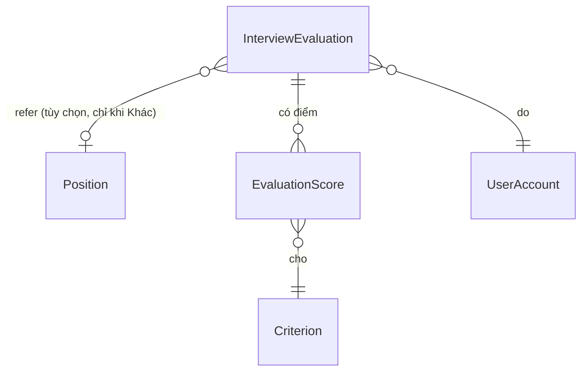

# Mô hình thực thể — U2 scoring-complete

U2 không thêm bảng mới. U2 hoàn thiện thực thể `InterviewEvaluation` (kết luận, refer, điểm trung bình bắt buộc ở tầng API), thêm ràng buộc DB, và định nghĩa hai dạng dữ liệu đọc (`EvaluationDetail`, `MyEvaluationSummary`) cùng đặc tả điểm trung bình dùng chung. Các thực thể khác của U1 không đổi (xem `construction/u1-scoring-skeleton/functional-design/entities.md`). Không có mã, không có SQL.

## Sources

- `construction/u1-scoring-skeleton/functional-design/entities.md` — `InterviewEvaluation`, `EvaluationScore`, `Position`, `Criterion`
- `inception/contract-design/contract-summary.md` — `EvaluationDetail`, `MyEvaluationSummary`, C5 `averageScoreSpec`
- `inception/domain-design/decisions.md` — ADR-002, ADR-003
- `construction/u2-scoring-complete/functional-design/functional-design-questions.md` — Q1 = A, Q2 = A, Q3 = A
- `docker/schema/schema.sql` — các cột `ket_luan`, `refer_ma_vi_tri`, `refer_ly_do`, `diem_trung_binh` đã có từ U1

## Khối nguồn chính thức

```yaml
entities:
  - name: InterviewEvaluation
    owner: Evaluation
    description: Phiếu đánh giá đã hoàn thành. U2 làm kết luận bắt buộc ở tầng API, thêm refer có điều kiện và điểm trung bình do server tính.
    attributes:
      - { name: evaluationId, type: id, required: true, unique: true, description: Do server sinh }
      - { name: userId, type: id, required: true, references: UserAccount.userId }
      - { name: maHdpv, type: text, required: true, references: InterviewPanel.maHdpv }
      - { name: maUngVien, type: text, required: true, references: Candidate.maUngVien }
      - { name: nhanXet, type: text, required: false, max: 2000 }
      - { name: idempotencyKey, type: uuid, required: true }
      - { name: trangThai, type: enum, required: true, allowed: [SUBMITTED], default: SUBMITTED }
      - { name: submittedAt, type: timestamp, required: true }
      - { name: ketLuan, type: enum, required: false, allowed: [DAT, LOAI, CAN_NHAC, KHAC], description: "Bắt buộc với bài mới qua API (BR5.1); rỗng chỉ với bài cũ từ U1 (BR7.7)" }
      - { name: referMaViTri, type: text, required: false, max: 50, references: Position.maViTri, constraints: "Chỉ có giá trị khi ketLuan = KHAC; Position đang ACTIVE và khác vị trí hiện tại của ứng viên khi ghi (BR5.2, BR5.3)" }
      - { name: referLyDo, type: text, required: false, max: 500, constraints: "Chỉ có giá trị khi có referMaViTri (BR5.2, BR5.4)" }
      - { name: diemTrungBinh, type: decimal, required: false, constraints: "Server tính theo BR6.1, BR6.2; 2 chữ số thập phân, trong khoảng 0,00..5,00; mọi bài có sau migration (BR9.3)" }
    constraints:
      - "Duy nhất theo bộ ba (userId, maHdpv, maUngVien)"
      - "Duy nhất theo (userId, idempotencyKey)"
      - "Bản ghi SUBMITTED không bị sửa hoặc xóa"
      - "referMaViTri chỉ khi ketLuan = KHAC; referLyDo chỉ khi có referMaViTri (BR9.1)"
    relationships:
      - { to: UserAccount, cardinality: "N:1", direction: "InterviewEvaluation -> UserAccount" }
      - { to: InterviewPanel, cardinality: "N:1", direction: "InterviewEvaluation -> InterviewPanel" }
      - { to: Candidate, cardinality: "N:1", direction: "InterviewEvaluation -> Candidate" }
      - { to: Position, cardinality: "N:1", direction: "InterviewEvaluation -> Position (vị trí refer, tùy chọn)" }

  - name: AverageScoreSpec
    owner: Evaluation
    description: Đặc tả thuần của công thức điểm trung bình cùng bộ ví dụ dùng chung giữa Node.js và Dart. Không phải bảng DB.
    attributes:
      - { name: scores, type: list, required: true, description: "Danh sách (diem, diemToiDa) của các tiêu chí đã chọn điểm" }
      - { name: stored100, type: integer, required: false, description: "Điểm trung bình nhân 100, làm tròn nửa lên; rỗng nếu không có điểm nào" }
      - { name: display10, type: integer, required: false, description: "Điểm hiển thị nhân 10, làm tròn nửa lên từ stored100" }
    constraints:
      - "Một tệp ví dụ duy nhất shared/average-score-examples.json; cả backend và app đọc tệp này (BR6.6)"
      - "Tính bằng số nguyên theo mẫu số chung 60 (BR6.2)"
    relationships:
      - { to: Criterion, cardinality: "N:N", direction: "AverageScoreSpec -> Criterion (chỉ qua diemToiDa)" }

  - name: EvaluationDetail
    owner: Evaluation
    description: Dạng đọc chỉ đọc của một bài đã hoàn thành của chính người gọi, trả bởi GET evaluation. Không lưu riêng.
    attributes:
      - { name: evaluationId, type: id, required: true }
      - { name: maHdpv, type: text, required: true }
      - { name: maUngVien, type: text, required: true }
      - { name: diem, type: list, required: true, description: "Mỗi phần tử: maTieuChi, tenTieuChi, diemToiThieu, diemToiDa, diem; gồm cả tiêu chí đã INACTIVE" }
      - { name: ketLuan, type: enum, required: false, allowed: [DAT, LOAI, CAN_NHAC, KHAC] }
      - { name: refer, type: object, required: false, description: "maViTri, job, lyDo; chỉ có khi ketLuan = KHAC và đã chọn vị trí" }
      - { name: diemTrungBinh, type: decimal, required: false }
      - { name: nhanXet, type: text, required: false }
      - { name: submittedAt, type: timestamp, required: true }
      - { name: trangThai, type: enum, required: true, allowed: [SUBMITTED] }
    constraints:
      - "Chỉ trả cho đúng userId trong token (BR7.5)"
    relationships:
      - { to: InterviewEvaluation, cardinality: "1:1", direction: "EvaluationDetail -> InterviewEvaluation" }

  - name: MyEvaluationSummary
    owner: Evaluation
    description: Dạng đọc tóm tắt các bài của người gọi trong một HĐPV, để app ghép vào S2 và S3 (ADR-002). U2 thêm hai trường.
    attributes:
      - { name: maUngVien, type: text, required: true }
      - { name: submittedAt, type: timestamp, required: true }
      - { name: ketLuan, type: enum, required: false, allowed: [DAT, LOAI, CAN_NHAC, KHAC], description: "Cột do U2 thêm; rỗng với bài cũ" }
      - { name: diemTrungBinh, type: decimal, required: false, description: "Cột do U2 thêm" }
    constraints:
      - "Chỉ gồm bài của người gọi (BR8.3)"
    relationships:
      - { to: InterviewEvaluation, cardinality: "1:1", direction: "MyEvaluationSummary -> InterviewEvaluation" }
```

## Sơ đồ quan hệ phần U2 (dẫn xuất)



Văn bản thay thế: phiếu đánh giá có nhiều dòng điểm, mỗi dòng cho một tiêu chí; phiếu thuộc một tài khoản; phiếu có thể trỏ tới một vị trí refer nhưng chỉ khi kết luận là Khác.

## Tóm tắt

| Thực thể | Thay đổi ở U2 |
|---|---|
| InterviewEvaluation | Kết luận bắt buộc ở API; refer có điều kiện; điểm trung bình server tính; ràng buộc DB; điền bù bài cũ |
| AverageScoreSpec | Mới (đặc tả, không có bảng): công thức số nguyên và tệp ví dụ dùng chung |
| EvaluationDetail | Mới (dạng đọc): bài của tôi, gồm tiêu chí đã ngừng |
| MyEvaluationSummary | Thêm `ketLuan`, `diemTrungBinh` |

## Assumptions & Open Questions

- **[assumption]** `referMaViTri` có khóa ngoại tới `Position` nhưng không có cascade; vị trí bị chuyển INACTIVE sau này vẫn hiện ở bài cũ vì `EvaluationDetail` trả tên vị trí theo mã bất kể trạng thái.
- **[assumption]** `diemTrungBinh` nằm trong 0,00..5,00 vì mỗi điểm đã quy về thang 5 và tối thiểu là 1 theo thang tiêu chí; ràng buộc khoảng được kiểm ở code, không cần CHECK riêng.
- **Open question:** None.
