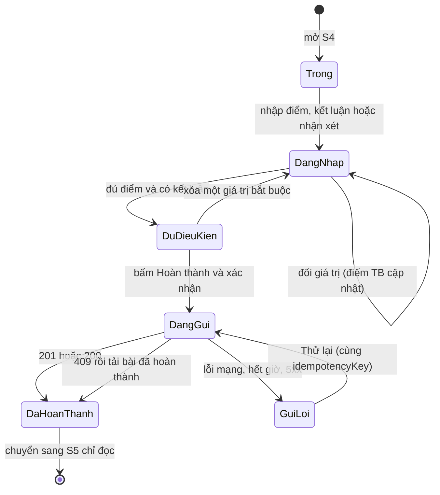
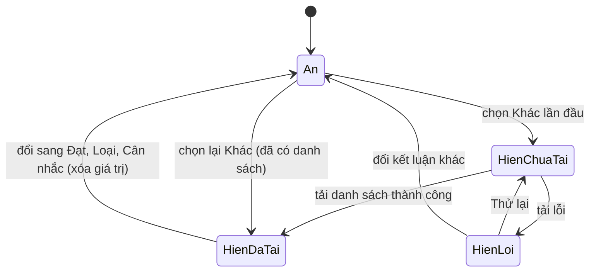

# Đặc tả chức năng — U2 scoring-complete

U2 hoàn thiện phiếu chấm điểm: kết luận Đạt / Loại / Cân nhắc / Khác, refer sang vị trí khác, điểm trung bình hiển thị ngay và lưu do server tính, hoàn thành an toàn khi mất mạng, xem lại bài đã hoàn thành và đăng xuất. Sau U2, release R1 (U1 + U2) đủ 13 story Must Have chạy được. Tài liệu này là nguồn chính thức cho luồng xử lý và trạng thái; `entities.md` và `rules.md` là nguồn cho dữ liệu và quy tắc.

## Sources

- `construction/u2-scoring-complete/functional-design/entities.md`, `rules.md`
- `construction/u1-scoring-skeleton/functional-design/functional-spec.md` — WF-4, WF-5, WF-6 làm nền
- `inception/units-generation/unit-of-work.md`, `unit-of-work-story-map.md` — phạm vi U2
- `inception/contract-design/contract-summary.md` — C1, C5
- `inception/domain-design/decisions.md` — ADR-002, ADR-003
- `construction/u2-scoring-complete/functional-design/functional-design-questions.md` — Q1 = A, Q2 = A, Q3 = A

## Phạm vi U2 và điều chỉnh hợp đồng

- Trong phạm vi: US5.3, US5.4, US5.8, US6.2, US6.3, US1.2; phần U2 của US2.1 (đã chấm / tổng), US4.1 (nhãn kết luận, cột Điểm TB), US6.1 (kết luận bắt buộc, refer, điểm trung bình); màn S5 và mở rộng S2, S3, S4.
- Ngoài phạm vi: cảnh báo hai khung và phím mũi tên đổi điểm (U5), CV (U3), AI (U4), giao diện chung nâng cao (U5), lưu nháp bền (đã loại ở Q1 = A).
- API mới: `GET /panels/{maHdpv}/candidates/{maUngVien}/referable-positions`, `GET /panels/{maHdpv}/candidates/{maUngVien}/evaluation`.
- API mở rộng: `POST .../evaluation` nhận thêm `ketLuan` (bắt buộc), `referMaViTri`, `referLyDo` và trả thêm `ketLuan`, `diemTrungBinh`; `GET /panels/{maHdpv}/my-evaluations` trả thêm `ketLuan`, `diemTrungBinh`. Trường `diemTrungBinh` do client gửi bị bỏ qua.
- Thay đổi phá vỡ đã định trước: `ketLuan` từ không có thành bắt buộc, nằm trong ngoại lệ trước phát hành của hợp đồng (U1 và U2 phát hành cùng nhau).
- Thay đổi DB: migration `002-u2-constraints.sql` và lệnh `node scripts/migrate.mjs` (Q2 = A).
- Điều chỉnh hợp đồng cần cập nhật khi viết mã: `contract-summary.md` và `backend/openapi.yaml` (thêm mã lỗi `EVALUATION_NOT_FOUND`, `ketLuan` nullable trong `EvaluationDetail` và `MyEvaluationSummary` cho bài cũ).

## Quy trình

### WF-7 Chấm điểm đầy đủ (mở rộng WF-5, WF-6)

1. Mở S4 như WF-5. App sinh `idempotencyKey` một lần cho lần mở này và giữ trong bộ nhớ màn hình (BR7.1).
2. Người dùng chọn điểm; khối Điểm trung bình cập nhật ngay theo BR6.5 bằng hàm thuần theo BR6.2; trình đọc màn hình nghe giá trị mới.
3. Người dùng chọn một trong bốn kết luận (BR5.7). Không chọn sẵn; điểm trung bình không ảnh hưởng lựa chọn (BR5.5).
4. Khi chọn `Khác`: khối Giới thiệu hiện ra, trình đọc màn hình nghe "Đã hiện ô giới thiệu sang vị trí khác", app gọi `referable-positions` (một lần mỗi lần mở màn, Q3 = A). Mặc định "Không refer"; chọn vị trí thì ô lý do mở. Đổi sang kết luận khác thì khối ẩn và xóa giá trị (BR5.8).
5. Nút Hoàn thành đánh giá mở khi đủ điểm và có kết luận; bấm khi khóa thì đánh dấu mục thiếu (BR5.9, BR3.3).
6. Bấm Hoàn thành, xác nhận hộp thoại (BR7.8), app đặt cờ đang gửi và vô hiệu nút (BR7.3), gọi `POST .../evaluation` với `idempotencyKey`, `diem[]`, `ketLuan`, `referMaViTri`, `referLyDo`, `nhanXet`.
7. Server theo thứ tự: xác thực token → chính sách `canComplete` (BR2.1, BR3.5) → kiểm payload (điểm BR3.2, BR3.3; nhận xét BR3.4; kết luận BR5.1; refer BR5.2, BR5.3, BR5.4; 400 nếu sai) → tra `idempotencyKey` (BR3.7, BR7.4) → kiểm phiếu đã có của tôi (BR3.6, 409) → tính `diemTrungBinh` (BR6.3) → ghi phiếu và dòng điểm trong một giao dịch (BR3.9) → ghi audit (BR8.5) → `201` kèm `evaluationId`, `submittedAt`, `trangThai`, `ketLuan`, `diemTrungBinh`.
8. App nhận `201` hoặc `200`: chuyển sang S5 (chỉ đọc) với dữ liệu vừa nhận, thông báo "Đã hoàn thành đánh giá" 3 giây cho cả trình đọc màn hình, danh sách S3 làm mới để hiện Đã chấm, nhãn kết luận và Điểm TB.

### WF-8 Mất mạng khi hoàn thành (BR7.2)

1. Gửi lỗi mạng, hết 10 giây hoặc `5xx`: app giữ nguyên form, hiện "Chưa hoàn thành được" và nút Thử lại; không báo thành công.
2. Bấm Thử lại: gửi lại cùng `idempotencyKey`. Nếu lần trước thực ra đã thành công ở server, server trả `200` với phiếu đã lưu; app xử lý như thành công.
3. Nhận `409` (đã có phiếu với khóa khác): thông báo "Bạn đã hoàn thành đánh giá cho ứng viên này" và tải bài đã hoàn thành ở dạng chỉ đọc.
4. Nhận `400`: đánh dấu trường lỗi mà server chỉ ra, giữ dữ liệu. Nhận `401`: về đăng nhập (dữ liệu chưa gửi mất, theo Q1 = A).
5. Đóng hoặc tải lại app khi chưa gửi được: dữ liệu chưa hoàn thành mất, đúng quyết định không lưu nháp. Cảnh báo "Dữ liệu chưa lưu sẽ mất" khi rời màn vẫn áp dụng (BR7.8).

### WF-9 Xem lại bài đã hoàn thành

1. Ở S3, chọn ứng viên có trong `my-evaluations` thì mở S5; ngược lại mở S4 (BR7.6).
2. S5 gọi `GET .../evaluation`. Server kiểm quyền (403/404 theo BR7.5), trả điểm từng tiêu chí (kể cả tiêu chí đã ngừng), kết luận, refer, điểm trung bình đã lưu, nhận xét, thời điểm hoàn thành.
3. S5 hiển thị mọi thứ chỉ đọc; khối refer chỉ khi kết luận là Khác; bài cũ không có kết luận hiển thị "Chưa ghi kết luận" (BR7.7). Không có nút sửa hay hoàn thành lại.
4. Người dùng khác (kể cả cùng HĐPV) không thể đọc bài này: API tra theo `userId` trong token.

### WF-10 Danh sách có kết quả (mở rộng WF-3, WF-4)

1. S3 ghép danh sách ứng viên với `my-evaluations`: dòng đã chấm hiển thị "Đã chấm", nhãn kết luận (chữ và biểu tượng) và "Điểm TB 3,8"; dòng chưa chấm hiển thị "Chưa chấm" (BR8.3).
2. S2 hiển thị "đã chấm / tổng" cho từng HĐPV bằng cách gọi `my-evaluations` song song; lỗi một HĐPV chỉ làm dòng đó hiển thị "—" và nút Thử lại cục bộ (BR8.4).

### WF-11 Đăng xuất

1. Người dùng bấm Đăng xuất (trên thanh tiêu đề các màn nghiệp vụ). Nếu S4 có dữ liệu chưa hoàn thành, hỏi xác nhận trước.
2. App xóa token khỏi kho lưu an toàn, hủy request đang chạy, hủy dữ liệu nghiệp vụ trong bộ nhớ, thay toàn bộ ngăn xếp điều hướng bằng S1 (BR8.1).
3. Nút quay lại không mở lại màn nghiệp vụ; request kế tiếp không kèm token. Token không bị thu hồi ở server (BR8.2).

### WF-12 Nâng cấp DB đã có dữ liệu (người vận hành)

1. Chạy `node scripts/migrate.mjs`. Lệnh đọc bảng `SCHEMA_MIGRATIONS`, áp dụng các tệp chưa chạy theo thứ tự, dừng mã khác 0 nếu lỗi (BR9.2).
2. Migration 002 điền bù `diem_trung_binh` cho bài cũ rồi thêm ràng buộc BR9.1. Chạy lại không đổi gì.
3. DB dựng mới từ `schema.sql` đã có sẵn kết quả và được đánh dấu 002 là đã áp dụng.

## Máy trạng thái

### Biểu mẫu chấm điểm (S4, ở app)

### Khối Giới thiệu sang vị trí khác

### Phiếu đánh giá ở server

Không đổi so với U1: chỉ có `SUBMITTED`, không sửa, không xóa; gửi lại cùng khóa trả bản cũ (BR3.8, BR7.4).

## Màn hình

| Màn | Thay đổi ở U2 | Trạng thái giao diện |
|---|---|---|
| S2 Danh sách HĐPV | Thêm "đã chấm / tổng"; nút Đăng xuất | Đang tải; rỗng; lỗi + Thử lại; số đã chấm lỗi cục bộ "—" |
| S3 Danh sách ứng viên | Thêm nhãn kết luận và Điểm TB ở dòng đã chấm; chọn dòng đã chấm mở S5 | Như U1 |
| S4 Chấm điểm | Thêm khối Kết luận, khối Giới thiệu (khi Khác), khối Điểm trung bình; nút khóa tính cả kết luận; trạng thái đang gửi và lỗi gửi | Đang gửi; "Chưa hoàn thành được" + Thử lại; "Chưa chọn kết luận"; tải vị trí lỗi + Thử lại |
| S5 Bài đã hoàn thành (mới) | Điểm từng tiêu chí, kết luận, refer (khi Khác), điểm trung bình, nhận xét, thời điểm hoàn thành, chỉ đọc | Đang tải; lỗi + Thử lại; không tồn tại bài (404) quay về S3 |

Bố cục lấy từ mockup đã duyệt (`inception/refined-mockups/`); giao diện ở mức dùng được, chủ đề chung nâng cao thuộc U5.

## Dữ liệu mẫu và lệnh xác minh

- Dữ liệu mẫu (`data/sample/seed.json`) thêm vị trí thứ hai đang hoạt động để kiểm refer, và một vị trí `INACTIVE` để kiểm danh sách vị trí loại vị trí ngừng.
- `npm --prefix backend run verify:e2e` mở rộng: hoàn thành với từng kết luận; `Khác` kèm refer hợp lệ; refer sai (kết luận không phải Khác, vị trí trùng, vị trí ngừng, lý do không vị trí) trả `400`; `diemTrungBinh` do client gửi bị bỏ qua; `GET evaluation` trả đúng; người dùng khác nhận `403` hoặc `404`; migration chạy lại không đổi gì.

## Tóm tắt quy tắc (dẫn xuất từ rules.md)

| Nhóm | Điểm chính |
|---|---|
| BR5 | Kết luận bắt buộc; refer chỉ khi Khác; vị trí hợp lệ; chỉ là đề xuất; giao diện kết luận và refer |
| BR6 | Công thức số nguyên mẫu số 60; lưu 2, hiển thị 1 chữ số; server tự tính; ví dụ dùng chung |
| BR7 | Cùng khóa khi Thử lại; giữ form khi lỗi; chống bấm đúp; xem lại bài của tôi; bài cũ không kết luận |
| BR8 | Đăng xuất; nhãn và Điểm TB ở S3; đã chấm trên tổng ở S2; audit |
| BR9 | Ràng buộc DB; migration; điền bù |

## Assumptions & Open Questions

- **[assumption]** "Chưa ghi kết luận" cho bài cũ chỉ xảy ra với dữ liệu tạo ở U1 (demo và kiểm thử); không có dữ liệu thật cần xử lý.
- **[assumption]** S5 dùng lại đường dẫn điều hướng sâu của S4 (cùng `maHdpv` và `maUngVien`) để làm mới trang web không mất ngữ cảnh.
- **Open question:** None.
