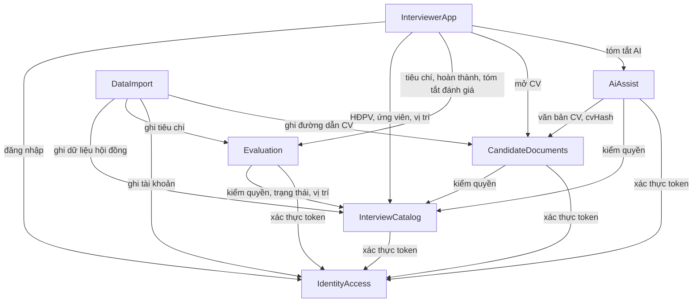

# Danh mục khối logic — App thực hiện phỏng vấn (MVP)

## Sources

- `aidlc/spaces/default/intents/261009-interview-execution-app/inception/requirements-analysis/requirements.md` — FR-A0..FR-A10, BR-A1..BR-A5, NFR-6, NFR-8..NFR-12, DEC-1..DEC-5
- `aidlc/spaces/default/intents/261009-interview-execution-app/inception/user-stories/stories.md` — US1.1..US8.6 (25 story)
- `aidlc/spaces/default/intents/261009-interview-execution-app/inception/practices-discovery/team-practices.md` — TDD, Node.js + Flutter
- `aidlc/spaces/default/intents/261009-interview-execution-app/inception/domain-design/domain-design-questions.md` — Q1 = A (sáu khối backend), Q2 = A (app tự ghép danh sách), Q3 = A (công thức điểm trung bình dùng chung)

Phạm vi: chỉ là các khối mã sẽ viết và khối nào sở hữu dữ liệu nào. Không quyết định cách triển khai (một tiến trình hay nhiều dịch vụ), công nghệ cụ thể hay kiểu dữ liệu; các việc đó thuộc Units Generation, NFR và Functional Design. Oracle, kho tệp CV và nhà cung cấp AI là phụ thuộc bên ngoài, không phải khối.

## Danh mục (nguồn chính thức)

```yaml
components:
  - name: IdentityAccess
    summary: Tài khoản người phỏng vấn, đăng nhập và xác thực token
    behaviour: >
      Đăng nhập bằng email và mật khẩu; so khớp mật khẩu băm bcrypt; email không phân biệt hoa thường;
      tài khoản bị khóa thì từ chối (403); sai thông tin trả thông báo chung, không lộ email có tồn tại (401).
      Phát JWT ký bằng khóa bí mật lấy từ biến môi trường, chứa userId và employedId, hạn 8 giờ, không có refresh token.
      Cung cấp hàm xác thực token cho các khối khác; token thiếu, sai hoặc hết hạn thì 401.
      Không bao giờ lưu hay ghi log mật khẩu dạng rõ. Tạo hoặc cập nhật tài khoản (theo email) cho DataImport, băm mật khẩu khi tạo.
    responsibilities:
      - Lưu tài khoản và mật khẩu đã băm
      - Đăng nhập và phát token
      - Xác thực token cho mọi API nghiệp vụ
      - Tạo / cập nhật tài khoản khi nạp dữ liệu
    depends_on: []
    dependents:
      - component: InterviewCatalog
        interaction: Xác thực token, lấy userId và employedId của người gọi
      - component: Evaluation
        interaction: Xác thực token, lấy userId của người chấm
      - component: CandidateDocuments
        interaction: Xác thực token
      - component: AiAssist
        interaction: Xác thực token
      - component: DataImport
        interaction: Tạo hoặc cập nhật tài khoản người phỏng vấn
      - component: InterviewerApp
        interaction: Đăng nhập, nhận token
    external_dependencies:
      - name: Oracle Database XE
        kind: database
        purpose: Lưu tài khoản
    entities:
      - name: UserAccount
        identifier: userId
        attributes: [userId, email, passwordHash, employedId, hoTen, trangThai]
        references:
          - entity: Interviewer
            owned_by: InterviewCatalog
            relationship: mỗi tài khoản gắn với một CBQL qua employedId

  - name: InterviewCatalog
    summary: Dữ liệu hội đồng phỏng vấn, vị trí, ứng viên, lịch, người phỏng vấn và chính sách truy cập
    behaviour: >
      Là nơi duy nhất áp dụng chính sách truy cập: người phỏng vấn chỉ thấy HĐPV mình được gán qua Chi tiết HĐPV – CBQL;
      chỉ HĐPV trạng thái Inprogress được liệt kê và mở (BR-A2); chỉ ứng viên Xác nhận = Y được liệt kê và mở (BR-A1);
      không được gán thì 403, không tồn tại hoặc không đủ điều kiện thì 404. Kiểm tra ở server.
      Danh sách HĐPV sắp theo ngày rồi theo mã; danh sách ứng viên của HĐPV gồm mọi vị trí, sắp theo giờ bắt đầu
      từ sớm đến muộn, cùng giờ thì mã nhỏ trước. Trả thông tin ứng viên tối thiểu (không trả số điện thoại, ngày sinh, giới tính).
      Cung cấp truy vấn chính sách cho các khối khác: được phép mở để chấm (Inprogress), được phép hoàn thành
      (Inprogress hoặc Completed), vị trí hiện tại của ứng viên, danh sách vị trí đang hoạt động.
      App Phase 2 không đổi trạng thái HĐPV; trạng thái chỉ đến từ dữ liệu nạp.
    responsibilities:
      - Lưu HĐPV, vị trí, ứng viên, CBQL và hai bảng chi tiết
      - Liệt kê HĐPV được gán và ứng viên đã xác nhận lịch
      - Áp dụng chính sách truy cập BR-A1, BR-A2 cho mọi khối
      - Cung cấp danh sách vị trí cho refer
      - Ghi dữ liệu khi DataImport nạp
    depends_on:
      - component: IdentityAccess
        interaction: Xác thực token của người gọi
        style: sync
    dependents:
      - component: Evaluation
        interaction: Kiểm tra quyền, trạng thái HĐPV, Xác nhận ứng viên, vị trí hiện tại, vị trí hợp lệ để refer
      - component: CandidateDocuments
        interaction: Kiểm tra quyền xem CV theo BR-A1, BR-A2
      - component: AiAssist
        interaction: Kiểm tra quyền trước khi tạo tóm tắt
      - component: DataImport
        interaction: Ghi HĐPV, vị trí, ứng viên, CBQL, lịch
      - component: InterviewerApp
        interaction: Lấy danh sách HĐPV, danh sách ứng viên, thông tin ứng viên, danh sách vị trí
    external_dependencies:
      - name: Oracle Database XE
        kind: database
        purpose: Lưu dữ liệu hội đồng, ứng viên, vị trí, lịch
    entities:
      - name: Position
        identifier: maViTri
        attributes: [maViTri, job, dvql, dvtt1, dvtt2, dvtt3, trangThai]
      - name: Candidate
        identifier: maUngVien
        attributes: [maUngVien, ten, maViTri, sdt, email, ngaySinh, gioiTinh, kinhNghiem, trinhDo]
        references:
          - entity: Position
            owned_by: InterviewCatalog
            relationship: mỗi ứng viên ứng tuyển một vị trí
      - name: Interviewer
        identifier: employedId
        attributes: [employedId, ten, job, donVi, email]
      - name: InterviewPanel
        identifier: maHdpv
        attributes: [maHdpv, ten, diaDiem, ngay, hinhThuc, daGuiEmail, trangThai]
      - name: PanelCandidate
        identifier: id
        attributes: [id, maHdpv, maUngVien, tuThoiGian, denThoiGian, xacNhan]
        references:
          - entity: InterviewPanel
            owned_by: InterviewCatalog
            relationship: dòng lịch thuộc một HĐPV
          - entity: Candidate
            owned_by: InterviewCatalog
            relationship: dòng lịch của một ứng viên
      - name: PanelInterviewer
        identifier: id
        attributes: [id, maHdpv, maCbql, tuThoiGian, denThoiGian, xacNhan]
        references:
          - entity: InterviewPanel
            owned_by: InterviewCatalog
            relationship: người phỏng vấn được gán vào một HĐPV
          - entity: Interviewer
            owned_by: InterviewCatalog
            relationship: dòng gán của một CBQL

  - name: Evaluation
    summary: Tiêu chí chấm điểm, phiếu đánh giá, điểm từng tiêu chí, kết luận, refer và điểm trung bình
    behaviour: >
      Trả các tiêu chí đang hoạt động theo thứ tự; tiêu chí ngừng không xuất hiện ở phiếu mới nhưng vẫn hiển thị ở bài cũ.
      Hoàn thành đánh giá: kiểm quyền và trạng thái qua InterviewCatalog (HĐPV Inprogress hoặc Completed, ứng viên Xác nhận = Y);
      mọi tiêu chí đang hoạt động phải có điểm nguyên trong thang; kết luận bắt buộc thuộc DAT, LOAI, CAN_NHAC, KHAC;
      refer chỉ khi kết luận là KHAC, tối đa một vị trí đang hoạt động khác vị trí hiện tại, lý do tối đa 500 ký tự;
      nhận xét tùy chọn tối đa 2000 ký tự. Ghi một giao dịch: phiếu đánh giá trạng thái SUBMITTED và các dòng điểm.
      Duy nhất một phiếu cho mỗi (người chấm, HĐPV, ứng viên); cùng idempotencyKey gửi lại thì trả bản đã lưu (200),
      khác khóa thì 409. Không có sửa hay xóa trong MVP. Tự tính điểm trung bình theo công thức dùng chung
      (trung bình cộng, quy về thang 5), lưu cùng phiếu, bỏ qua giá trị client gửi.
      Kết luận, refer và điểm trung bình chỉ là đề xuất (BR-A3, BR-A5): không đổi dữ liệu hay vị trí của ứng viên.
      Chỉ người chấm đọc được phiếu của mình (người khác 403). Cung cấp tóm tắt đánh giá của tôi theo HĐPV
      (đã chấm, điểm trung bình, kết luận) để app ghép vào danh sách.
    responsibilities:
      - Lưu tiêu chí, phiếu đánh giá và điểm
      - Kiểm tra và hoàn thành đánh giá (khóa, chống gửi trùng)
      - Tính và lưu điểm trung bình; giữ đặc tả công thức và bộ test chung
      - Trả bài đã hoàn thành và tóm tắt đánh giá theo HĐPV
      - Ghi tiêu chí khi DataImport nạp
    depends_on:
      - component: InterviewCatalog
        interaction: Kiểm tra quyền, trạng thái HĐPV, Xác nhận ứng viên, vị trí hiện tại và vị trí hợp lệ để refer
        style: sync
      - component: IdentityAccess
        interaction: Xác thực token, lấy userId của người chấm
        style: sync
    dependents:
      - component: DataImport
        interaction: Ghi tiêu chí chấm điểm
      - component: InterviewerApp
        interaction: Lấy tiêu chí, hoàn thành đánh giá, xem bài, lấy tóm tắt đánh giá theo HĐPV
    external_dependencies:
      - name: Oracle Database XE
        kind: database
        purpose: Lưu tiêu chí, phiếu đánh giá, điểm
    entities:
      - name: Criterion
        identifier: maTieuChi
        attributes: [maTieuChi, tenTieuChi, diemToiThieu, diemToiDa, thuTu, trangThai]
      - name: InterviewEvaluation
        identifier: evaluationId
        attributes: [evaluationId, userId, maHdpv, maUngVien, ketLuan, nhanXet, referMaViTri, referLyDo, diemTrungBinh, idempotencyKey, trangThai, submittedAt]
        references:
          - entity: UserAccount
            owned_by: IdentityAccess
            relationship: mỗi phiếu do một người phỏng vấn hoàn thành
          - entity: InterviewPanel
            owned_by: InterviewCatalog
            relationship: mỗi phiếu thuộc một HĐPV
          - entity: Candidate
            owned_by: InterviewCatalog
            relationship: mỗi phiếu đánh giá một ứng viên
          - entity: Position
            owned_by: InterviewCatalog
            relationship: phiếu có thể đề xuất refer sang một vị trí khác
      - name: EvaluationScore
        identifier: "evaluationId + maTieuChi"
        attributes: [evaluationId, maTieuChi, diem]
        references:
          - entity: InterviewEvaluation
            owned_by: Evaluation
            relationship: mỗi dòng điểm thuộc một phiếu
          - entity: Criterion
            owned_by: Evaluation
            relationship: mỗi dòng điểm cho một tiêu chí

  - name: CandidateDocuments
    summary: CV của ứng viên, xem CV chỉ đọc và nhật ký xem
    behaviour: >
      Kiểm quyền qua InterviewCatalog (được gán, HĐPV Inprogress, ứng viên Xác nhận = Y) rồi mới cấp CV;
      ứng viên không có CV thì 404 CV_NOT_FOUND; tệp không đọc được thì 500 hoặc 502.
      Ghi nhật ký mỗi lần xem thành công trước khi trả nội dung. Cấp liên kết ngắn hạn 5 phút gắn với người dùng và ứng viên;
      client không thấy đường dẫn tệp thật. Không có tải xuống, in hay chia sẻ (biện pháp giao diện, không ngăn tuyệt đối chụp màn hình).
      Cung cấp văn bản trích từ CV và cvHash cho AiAssist sau cùng kiểm tra quyền.
      Ghi đường dẫn CV khi DataImport nạp; đường dẫn sai hoặc không phải PDF thì ghi cảnh báo, ứng viên hiển thị "Chưa có CV".
    responsibilities:
      - Lưu thông tin tệp CV
      - Cấp CV chỉ đọc qua liên kết ngắn hạn
      - Ghi nhật ký xem CV
      - Trích văn bản CV và tính cvHash cho AiAssist
    depends_on:
      - component: InterviewCatalog
        interaction: Kiểm tra quyền xem CV
        style: sync
      - component: IdentityAccess
        interaction: Xác thực token
        style: sync
    dependents:
      - component: AiAssist
        interaction: Lấy văn bản CV và cvHash
      - component: DataImport
        interaction: Ghi đường dẫn CV của ứng viên
      - component: InterviewerApp
        interaction: Mở CV chỉ đọc
    external_dependencies:
      - name: Kho tệp CV (thư mục trên máy chủ hoặc lưu trữ tệp)
        kind: object-store
        purpose: Chứa tệp PDF CV
      - name: Oracle Database XE
        kind: database
        purpose: Lưu thông tin tệp CV và nhật ký xem
    entities:
      - name: CvDocument
        identifier: maUngVien
        attributes: [maUngVien, cvPath, cvHash, coLopChu]
        references:
          - entity: Candidate
            owned_by: InterviewCatalog
            relationship: mỗi ứng viên có tối đa một CV
      - name: CvViewLog
        identifier: logId
        attributes: [logId, userId, maHdpv, maUngVien, thoiDiem]
        references:
          - entity: UserAccount
            owned_by: IdentityAccess
            relationship: người xem
          - entity: InterviewPanel
            owned_by: InterviewCatalog
            relationship: HĐPV mà người xem được gán
          - entity: Candidate
            owned_by: InterviewCatalog
            relationship: ứng viên có CV được xem

  - name: AiAssist
    summary: Tóm tắt CV bằng AI, mục kinh nghiệm / trình độ / chứng chỉ có đoạn trích, câu hỏi gợi ý
    behaviour: >
      Tắt theo mặc định bằng cờ ai.cvSummary.enabled; tắt thì 403 AI_DISABLED và không gửi dữ liệu ra ngoài.
      Kiểm quyền qua InterviewCatalog, lấy văn bản CV và cvHash qua CandidateDocuments; CV dạng ảnh thì 422 CV_NO_TEXT.
      Giới hạn số lần gọi theo người dùng mỗi giờ (429) và thời gian chờ. Có kết quả READY cùng cvHash và promptVersion thì
      trả kết quả đã lưu, trừ khi tạo lại. Che số điện thoại, email, ngày sinh, địa chỉ trước khi gửi.
      Kiểm kết quả theo lược đồ; loại mục không có đoạn trích nguyên văn trong CV; loại nội dung nhạy cảm
      (tuổi, giới tính, hôn nhân, tôn giáo, dân tộc, sức khỏe, quốc tịch); câu hỏi phải tham chiếu một mục có thật.
      Ghi nhật ký mỗi lần gọi. Không chấm điểm, không chọn kết luận, không tự điền phiếu (BR-A4).
      Khóa truy cập nhà cung cấp chỉ lấy từ biến môi trường.
    responsibilities:
      - Lưu kết quả tóm tắt AI theo CV
      - Gọi nhà cung cấp AI với dữ liệu đã che
      - Kiểm tra, lọc và trả tóm tắt, mục KN / TĐ / CC, câu hỏi gợi ý
      - Ghi nhật ký gọi AI; áp dụng cờ bật/tắt và giới hạn
    depends_on:
      - component: CandidateDocuments
        interaction: Lấy văn bản CV và cvHash
        style: sync
      - component: InterviewCatalog
        interaction: Kiểm tra quyền
        style: sync
      - component: IdentityAccess
        interaction: Xác thực token
        style: sync
    dependents:
      - component: InterviewerApp
        interaction: Tạo hoặc lấy tóm tắt AI
    external_dependencies:
      - name: Nhà cung cấp AI (chưa chọn, OQ-AI-1)
        kind: third-party-api
        purpose: Tạo tóm tắt và câu hỏi từ văn bản CV đã che
      - name: Oracle Database XE
        kind: database
        purpose: Lưu kết quả AI và nhật ký gọi
    entities:
      - name: CvAiSummary
        identifier: "maUngVien + cvHash + promptVersion"
        attributes: [maUngVien, cvHash, promptVersion, model, trangThai, tomTat, kinhNghiem, trinhDo, chungChi, cauHoiGoiY, taoLuc, taoBoi, maLoi]
        references:
          - entity: CvDocument
            owned_by: CandidateDocuments
            relationship: mỗi kết quả gắn với một phiên bản nội dung CV
          - entity: UserAccount
            owned_by: IdentityAccess
            relationship: người yêu cầu tạo
      - name: AiCallLog
        identifier: logId
        attributes: [logId, userId, maHdpv, maUngVien, thoiDiem, ketQua, thoiGianXuLy]
        references:
          - entity: UserAccount
            owned_by: IdentityAccess
            relationship: người gọi
          - entity: Candidate
            owned_by: InterviewCatalog
            relationship: ứng viên có CV được tóm tắt

  - name: DataImport
    summary: Công cụ dòng lệnh nạp dữ liệu theo Kiro_bang (1).xlsx cho người vận hành
    behaviour: >
      Đọc tệp nạp; kiểm tra trường bắt buộc, định dạng ngày giờ, Từ thời gian nhỏ hơn Đến thời gian, giá trị trạng thái HĐPV,
      thang tiêu chí, khóa tham chiếu. Ghi qua khối sở hữu từng dữ liệu theo thứ tự tiêu chí, vị trí, CBQL, tài khoản, ứng viên,
      CV, HĐPV, chi tiết; trong một giao dịch. Chạy lại không nhân đôi (trùng mã thì cập nhật).
      Bản ghi lỗi bị bỏ qua và ghi vào báo cáo kèm số dòng và lý do; mất kết nối thì hoàn tác và thoát mã lỗi khác 0.
      In báo cáo số thêm / cập nhật / lỗi theo nhóm. Không sở hữu dữ liệu nghiệp vụ.
    responsibilities:
      - Đọc và kiểm tra tệp nạp
      - Điều phối ghi dữ liệu qua các khối sở hữu
      - In báo cáo nạp
    depends_on:
      - component: InterviewCatalog
        interaction: Ghi HĐPV, vị trí, ứng viên, CBQL, lịch
        style: sync
      - component: Evaluation
        interaction: Ghi tiêu chí
        style: sync
      - component: IdentityAccess
        interaction: Tạo hoặc cập nhật tài khoản
        style: sync
      - component: CandidateDocuments
        interaction: Ghi đường dẫn CV
        style: sync
    dependents: []
    external_dependencies:
      - name: Tệp nạp JSON / CSV xuất từ Kiro_bang (1).xlsx
        kind: other
        purpose: Nguồn dữ liệu đầu vào
    entities: []

  - name: InterviewerApp
    summary: Ứng dụng Flutter (web và điện thoại) cho người phỏng vấn
    behaviour: >
      Các màn S1..S6 theo mockup đã duyệt. Lưu token an toàn, gắn vào mọi request; 401 thì xóa token và về đăng nhập.
      Ghép danh sách ứng viên từ InterviewCatalog với tóm tắt đánh giá của tôi từ Evaluation theo mã ứng viên (ADR-002).
      Tính điểm trung bình xem trước bằng cùng công thức với Evaluation (ADR-003); server là nguồn chính thức.
      Sinh idempotencyKey một lần cho mỗi phiếu; mất mạng thì giữ dữ liệu và gửi lại cùng khóa; không báo thành công khi chưa có phản hồi.
      Khối refer chỉ hiện khi kết luận là Khác; đổi kết luận khác thì xóa giá trị refer.
      Một họ phông sans-serif đóng gói, sáng / tối theo hệ thống, ba điểm ngắt, hai khung trên máy tính,
      khung xương khi tải, tôn trọng giảm chuyển động, WCAG 2.1 AA cơ bản, chuỗi chữ tiếng Việt gom một nơi.
      Không lưu dữ liệu nghiệp vụ lâu dài trên thiết bị (ngoài token).
    responsibilities:
      - Giao diện và điều hướng S1..S6
      - Ghép dữ liệu hiển thị từ các khối backend
      - Kiểm tra nhập liệu phía client và xem trước điểm trung bình
      - Giao diện chung NFR-6, NFR-9..NFR-12
    depends_on:
      - component: IdentityAccess
        interaction: Đăng nhập
        style: sync
      - component: InterviewCatalog
        interaction: Danh sách HĐPV, ứng viên, thông tin ứng viên, vị trí
        style: sync
      - component: Evaluation
        interaction: Tiêu chí, hoàn thành đánh giá, xem bài, tóm tắt đánh giá theo HĐPV
        style: sync
      - component: CandidateDocuments
        interaction: Mở CV
        style: sync
      - component: AiAssist
        interaction: Tạo hoặc lấy tóm tắt AI
        style: sync
    dependents: []
    external_dependencies:
      - name: Kho lưu trữ an toàn trên thiết bị / trình duyệt
        kind: other
        purpose: Lưu token đăng nhập
      - name: Gói xem PDF (chưa chọn)
        kind: other
        purpose: Hiển thị CV và làm nổi bật đoạn trích
    entities: []
```

## Sơ đồ khối



Văn bản thay thế: app gọi năm khối backend. Mọi khối API xác thực token qua IdentityAccess. Evaluation, CandidateDocuments và AiAssist hỏi InterviewCatalog để kiểm quyền. AiAssist lấy văn bản CV từ CandidateDocuments. DataImport ghi dữ liệu qua bốn khối sở hữu. Không có vòng phụ thuộc; IdentityAccess không phụ thuộc khối nào.

## Tóm tắt khối

| Khối | Mục đích | Phụ thuộc | Được gọi bởi | Thực thể sở hữu |
|---|---|---|---|---|
| IdentityAccess | Tài khoản, đăng nhập, xác thực token | — | InterviewCatalog, Evaluation, CandidateDocuments, AiAssist, DataImport, InterviewerApp | UserAccount |
| InterviewCatalog | HĐPV, vị trí, ứng viên, lịch, CBQL, chính sách truy cập | IdentityAccess | Evaluation, CandidateDocuments, AiAssist, DataImport, InterviewerApp | Position, Candidate, Interviewer, InterviewPanel, PanelCandidate, PanelInterviewer |
| Evaluation | Tiêu chí, phiếu đánh giá, điểm, kết luận, refer, điểm trung bình | InterviewCatalog, IdentityAccess | DataImport, InterviewerApp | Criterion, InterviewEvaluation, EvaluationScore |
| CandidateDocuments | CV chỉ đọc, nhật ký xem | InterviewCatalog, IdentityAccess | AiAssist, DataImport, InterviewerApp | CvDocument, CvViewLog |
| AiAssist | Tóm tắt CV bằng AI, câu hỏi gợi ý | CandidateDocuments, InterviewCatalog, IdentityAccess | InterviewerApp | CvAiSummary, AiCallLog |
| DataImport | Nạp dữ liệu dòng lệnh | InterviewCatalog, Evaluation, IdentityAccess, CandidateDocuments | — | — |
| InterviewerApp | Ứng dụng Flutter cho người phỏng vấn | IdentityAccess, InterviewCatalog, Evaluation, CandidateDocuments, AiAssist | — | — |

## Quyền sở hữu thực thể

| Thực thể | Khối sở hữu | Định danh | Thuộc tính | Tham chiếu |
|---|---|---|---|---|
| UserAccount | IdentityAccess | userId | userId, email, passwordHash, employedId, hoTen, trangThai | Interviewer |
| Position | InterviewCatalog | maViTri | maViTri, job, dvql, dvtt1, dvtt2, dvtt3, trangThai | — |
| Candidate | InterviewCatalog | maUngVien | maUngVien, ten, maViTri, sdt, email, ngaySinh, gioiTinh, kinhNghiem, trinhDo | Position |
| Interviewer | InterviewCatalog | employedId | employedId, ten, job, donVi, email | — |
| InterviewPanel | InterviewCatalog | maHdpv | maHdpv, ten, diaDiem, ngay, hinhThuc, daGuiEmail, trangThai | — |
| PanelCandidate | InterviewCatalog | id | id, maHdpv, maUngVien, tuThoiGian, denThoiGian, xacNhan | InterviewPanel, Candidate |
| PanelInterviewer | InterviewCatalog | id | id, maHdpv, maCbql, tuThoiGian, denThoiGian, xacNhan | InterviewPanel, Interviewer |
| Criterion | Evaluation | maTieuChi | maTieuChi, tenTieuChi, diemToiThieu, diemToiDa, thuTu, trangThai | — |
| InterviewEvaluation | Evaluation | evaluationId | evaluationId, userId, maHdpv, maUngVien, ketLuan, nhanXet, referMaViTri, referLyDo, diemTrungBinh, idempotencyKey, trangThai, submittedAt | UserAccount, InterviewPanel, Candidate, Position |
| EvaluationScore | Evaluation | evaluationId + maTieuChi | evaluationId, maTieuChi, diem | InterviewEvaluation, Criterion |
| CvDocument | CandidateDocuments | maUngVien | maUngVien, cvPath, cvHash, coLopChu | Candidate |
| CvViewLog | CandidateDocuments | logId | logId, userId, maHdpv, maUngVien, thoiDiem | UserAccount, InterviewPanel, Candidate |
| CvAiSummary | AiAssist | maUngVien + cvHash + promptVersion | maUngVien, cvHash, promptVersion, model, trangThai, tomTat, kinhNghiem, trinhDo, chungChi, cauHoiGoiY, taoLuc, taoBoi, maLoi | CvDocument, UserAccount |
| AiCallLog | AiAssist | logId | logId, userId, maHdpv, maUngVien, thoiDiem, ketQua, thoiGianXuLy | UserAccount, Candidate |

Kiểu dữ liệu, ràng buộc và quan hệ chi tiết để Functional Design (`entities.md`) quyết định.

## Phụ thuộc bên ngoài

| Khối | Phụ thuộc | Loại | Mục đích |
|---|---|---|---|
| IdentityAccess, InterviewCatalog, Evaluation, CandidateDocuments, AiAssist | Oracle Database XE (Docker, local, DB riêng) | database | Lưu dữ liệu của từng khối |
| CandidateDocuments | Kho tệp CV | object-store | Chứa tệp PDF |
| AiAssist | Nhà cung cấp AI (chưa chọn) | third-party-api | Tạo tóm tắt và câu hỏi |
| DataImport | Tệp nạp theo Kiro_bang (1).xlsx | other | Dữ liệu đầu vào |
| InterviewerApp | Kho lưu trữ an toàn trên thiết bị / trình duyệt | other | Lưu token |
| InterviewerApp | Gói xem PDF (chưa chọn) | other | Hiển thị CV, làm nổi bật |

## Lý do tách khối

| Khối | Vì sao là khối riêng |
|---|---|
| IdentityAccess | Mối quan tâm riêng (bảo mật mật khẩu, token); mọi khối khác cần; ít thay đổi |
| InterviewCatalog | Sở hữu dữ liệu nguồn Phase 1 và là nơi duy nhất áp dụng BR-A1, BR-A2; thay đổi khi cấu trúc Kiro_bang đổi |
| Evaluation | Giá trị cốt lõi của MVP; quy tắc chấm, khóa, chống gửi trùng, điểm trung bình; thay đổi theo nghiệp vụ chấm |
| CandidateDocuments | Dữ liệu nhạy cảm (CV) với quy tắc riêng: liên kết ngắn hạn, nhật ký xem, kho tệp; story Should Have nên tách để hoãn được |
| AiAssist | Tính năng tùy chọn, tắt mặc định, phụ thuộc nhà cung cấp bên ngoài và quyết định Legal; tách để bật / tắt / hoãn mà không ảnh hưởng lõi |
| DataImport | Chạy dòng lệnh, vòng đời khác (trước demo), không sở hữu dữ liệu |
| InterviewerApp | Mã client Flutter, nền tảng và vòng đời khác backend |

**Phương án đã cân nhắc (Q1):**
- Phương án A — Sáu khối backend tách theo quyền sở hữu dữ liệu (đã chọn): ranh giới rõ, CV và AI tách được; nhiều khối hơn; dễ gom lại ở Units Generation.
- Phương án B — Ba khối gộp (`InterviewCore`, `CandidateDocumentsAndAi`, `DataImport`): ít khối hơn nhưng khối lõi lớn, lẫn nhiều lý do thay đổi, AI dính với CV. **Bị loại** vì làm khó việc hoãn CV / AI khi cắt phạm vi.

Chi tiết các quyết định ở `decisions.md` (ADR-001..ADR-007).

## Assumptions & Open Questions

- **[assumption]** Mọi khối backend dùng chung một Oracle DB riêng, mỗi khối chỉ ghi bảng của mình; cách tách schema để Units Generation và thiết kế kỹ thuật quyết định.
- **[assumption]** "Chính sách truy cập" (được gán, Inprogress, Xác nhận = Y) đặt duy nhất trong InterviewCatalog; các khối khác gọi qua truy vấn chính sách thay vì tự đọc bảng của InterviewCatalog.
- **[assumption]** CV gắn với ứng viên (một CV cho mỗi ứng viên), không gắn theo HĐPV.
- **Open question:** Nhà cung cấp AI và gói xem PDF chưa chọn; không ảnh hưởng ranh giới khối.
