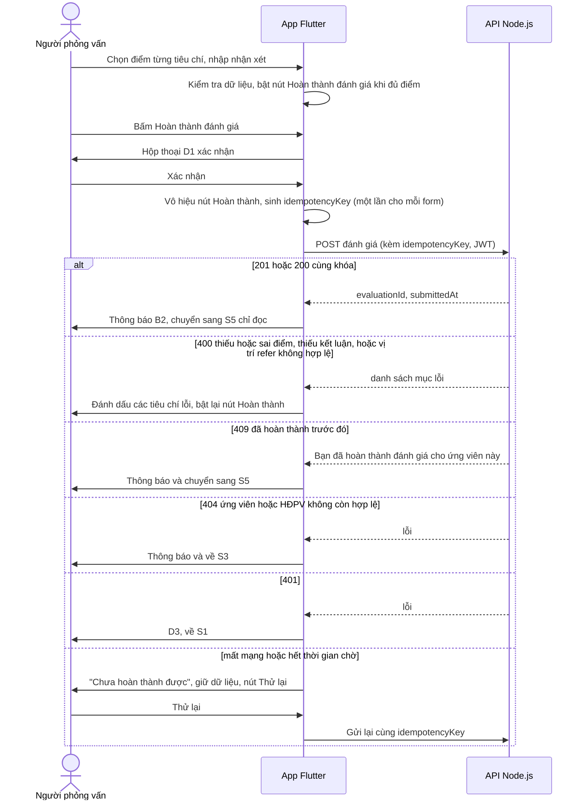
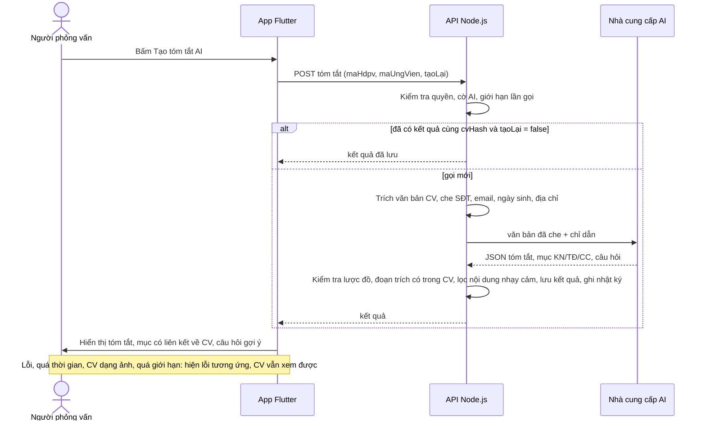

# Đặc tả tương tác — App thực hiện phỏng vấn (MVP 2 ngày)

## Sources

- `aidlc/spaces/default/intents/261009-interview-execution-app/inception/refined-mockups/mockups.md` — màn hình S1..S5, hộp thoại D1..D3
- `aidlc/spaces/default/intents/261009-interview-execution-app/inception/user-stories/stories.md` — tiêu chí chấp nhận AC1.1.x .. AC6.3.x
- `aidlc/spaces/default/intents/261009-interview-execution-app/inception/requirements-analysis/requirements.md` — quy ước lỗi API, FR-A0..A7

## Luồng tương tác chính

### Luồng hoàn thành đánh giá (US5.2, US6.1, US6.2)



Văn bản thay thế: sau khi người dùng xác nhận, app khóa nút, gửi đánh giá kèm mã chống gửi trùng; thành công thì chuyển sang màn chỉ đọc; thiếu điểm thì đánh dấu lại; đã hoàn thành thì chuyển sang màn chỉ đọc; không còn hợp lệ thì về danh sách; hết phiên thì về đăng nhập; mất mạng thì giữ dữ liệu và cho gửi lại với cùng mã.

### Quy tắc điều hướng

| Tình huống | Hành vi |
|---|---|
| Quay lại ở S4 khi chưa nhập gì | Về S3 ngay |
| Quay lại ở S4 khi đã nhập chưa hoàn thành | Hiện D2; `Ở lại` là lựa chọn mặc định |
| Quay lại ở S5, S3 | Về màn trước, không hỏi |
| Mở lại ứng viên đã chấm | Vào S5 chỉ đọc, không vào S4 |
| `401` ở bất kỳ API nào | Xóa token, D3, về S1 |
| Bấm Đăng xuất ở S2 | Xóa token, về S1; nút quay lại của thiết bị không đưa về màn nghiệp vụ |
| Làm mới trang web (F5) khi còn token hợp lệ | Giữ đăng nhập, vào lại S2 |
| Máy tính để bàn, bấm ứng viên khác khi S4 đang nhập dở | Hiện D2 trước khi chuyển |

## Đặc tả thành phần

## ScoreSelector (chọn điểm 1..5)

| Field | Value |
|---|---|
| Component | ScoreSelector |
| Description | Hàng 5 nút số để chọn điểm cho một tiêu chí |
| Category | input |

### States

| State | Description | Trigger |
|---|---|---|
| default | Chưa nút nào được chọn, 5 nút viền mảnh | mở form mới |
| hover | Nút nâng nhẹ, nền nhạt | di chuột (web) |
| focus | Viền nổi bật 2 px quanh nút | phím Tab hoặc mũi tên |
| selected | Nút đã chọn tô màu chủ đạo, có dấu tích | bấm hoặc Enter/Space |
| error | Cả hàng viền đỏ, chữ "Chưa chọn điểm" bên dưới | bấm Hoàn thành đánh giá khi tiêu chí còn trống |
| disabled | Nút mờ, không bấm được | đang hoàn thành |
| readonly | Hiện điểm đã chọn, không tương tác | bài đã hoàn thành (S5) |

### Props / Inputs

| Prop | Type | Required | Default | Description |
|---|---|---|---|---|
| maTieuChi | string | yes | — | Mã tiêu chí |
| tenTieuChi | string | yes | — | Tên hiển thị |
| diemToiThieu | number | no | 1 | Điểm nhỏ nhất của thang |
| diemToiDa | number | no | 5 | Điểm lớn nhất của thang |
| value | number \| null | no | null | Điểm đang chọn |
| onChanged | function(number) | yes | — | Gọi khi chọn điểm |
| hasError | boolean | no | false | Hiển thị trạng thái lỗi |
| readOnly | boolean | no | false | Chế độ chỉ đọc |

### Responsive Behaviour

| Breakpoint | Behaviour |
|---|---|
| mobile (<768px) | 5 nút chia đều chiều rộng, mỗi nút cao tối thiểu 48 px |
| tablet (768–1024px) | Như điện thoại, giới hạn tổng chiều rộng 360 px |
| desktop (>1024px) | Nút rộng 56 px, xếp cạnh nhau; thẻ tiêu chí xếp hai cột |

### Accessibility

| Requirement | Implementation |
|---|---|
| ARIA role | Nhóm nút chọn một (radio group) với nhãn là tên tiêu chí |
| Keyboard interaction | Tab vào nhóm; phím mũi tên trái/phải đổi điểm; Space hoặc Enter chọn |
| Label / aria-label | Mỗi nút đọc "Điểm 4 trên 5, <tên tiêu chí>" |
| Contrast ratio | WCAG AA (4.5:1 chữ, 3:1 thành phần giao diện) |
| Screen reader | Đọc điểm đã chọn khi thay đổi: "Đã chọn 4" |
| Focus management | Sau khi chọn, giữ nguyên tiêu điểm ở nút vừa chọn |

### Usage Example

```
ScoreSelector(
  maTieuChi: 'TC01',
  tenTieuChi: 'Kiến thức chuyên môn',
  value: scores['TC01'],
  onChanged: (v) => setScore('TC01', v),
)
```

---

## CandidateCard (thẻ ứng viên)

| Field | Value |
|---|---|
| Component | CandidateCard |
| Description | Một dòng ứng viên trong danh sách S3 |
| Category | display / navigation |

### States

| State | Description | Trigger |
|---|---|---|
| default (chưa chấm) | Nền thẻ đầy đủ, nhãn `Chưa chấm` có chấm tròn cam | dữ liệu tải xong |
| submitted (đã chấm) | Thẻ nhạt hơn, nhãn `Đã chấm` có dấu tích xanh | tôi đã hoàn thành đánh giá |
| hover | Thẻ nâng nhẹ | di chuột |
| focus | Viền nổi bật | phím Tab |
| selected | Nền nhấn màu chủ đạo nhạt, chỉ ở bố cục hai khung | đang xem chi tiết |
| loading | Khung xương | đang tải danh sách |

### Props / Inputs

| Prop | Type | Required | Default | Description |
|---|---|---|---|---|
| maUngVien | string | yes | — | Mã ứng viên |
| ten | string | yes | — | Tên ứng viên |
| viTri | string | yes | — | `job` và đơn vị |
| gioBatDau, gioKetThuc | string `hh:mm` | yes | — | Khung giờ |
| ngay | date | yes | — | Ngày phỏng vấn, dùng cho nhãn đọc |
| daCham | boolean | yes | — | Trạng thái chấm của tôi |
| selected | boolean | no | false | Đang chọn (hai khung) |
| onTap | function | yes | — | Mở S4 hoặc S5 |

### Responsive Behaviour

| Breakpoint | Behaviour |
|---|---|
| mobile (<768px) | Thẻ rộng toàn chiều ngang, giờ bên trái, nhãn ở góc phải dưới |
| tablet (768–1024px) | Thẻ tối đa 720 px, căn giữa |
| desktop (>1024px) | Thẻ trong khung trái rộng 400 px, cho phép tô nhấn khi đang chọn |

### Accessibility

| Requirement | Implementation |
|---|---|
| ARIA role | Nút / mục danh sách có thể bấm |
| Keyboard interaction | Tab di chuyển giữa thẻ; Enter hoặc Space mở |
| Label / aria-label | "Nguyễn Văn An, mã UV-1021, vị trí CV BA, 15/10/2026 08:30 đến 09:00, chưa chấm" |
| Contrast ratio | WCAG AA; thẻ đã chấm vẫn đạt 4.5:1 cho chữ |
| Screen reader | Trạng thái chấm nằm trong nhãn, không chỉ qua màu |
| Focus management | Khi quay lại từ S4/S5, tiêu điểm trở về thẻ vừa mở |

### Usage Example

```
CandidateCard(
  maUngVien: 'UV-1021', ten: 'Nguyễn Văn An', viTri: 'CV BA · Khối CNTT',
  gioBatDau: '08:30', gioKetThuc: '09:00', ngay: ngayHdpv,
  daCham: true, onTap: () => openCandidate('UV-1021'),
)
```

---

## HdpvCard (thẻ HĐPV)

| Field | Value |
|---|---|
| Component | HdpvCard |
| Description | Một HĐPV `Inprogress` trong S2 |
| Category | display / navigation |

### States

| State | Description | Trigger |
|---|---|---|
| default | Mã, tên, ngày, hình thức, địa điểm, thanh tiến độ | dữ liệu tải xong |
| hover | Thẻ nâng nhẹ | di chuột |
| focus | Viền nổi bật | phím Tab |
| loading | Khung xương | đang tải |
| complete | Thanh tiến độ đầy, nhãn "Đã chấm đủ" | đã chấm hết ứng viên xác nhận |

### Props / Inputs

| Prop | Type | Required | Default | Description |
|---|---|---|---|---|
| maHdpv, ten | string | yes | — | Mã và tên |
| ngay | date | yes | — | Ngày phỏng vấn |
| hinhThuc | `Online` \| `Offline` | yes | — | Nhãn hình thức |
| diaDiem | string | no | — | Địa điểm hoặc liên kết họp |
| daCham, tong | number | yes | — | Số đã chấm / tổng ứng viên đã xác nhận |
| onTap | function | yes | — | Mở S3 |

### Responsive Behaviour

| Breakpoint | Behaviour |
|---|---|
| mobile (<768px) | Một cột |
| tablet (768–1024px) | Một cột căn giữa tối đa 720 px |
| desktop (>1024px) | Lưới 2 đến 3 cột; thẻ ngày gần nhất rộng gấp đôi |

### Accessibility

| Requirement | Implementation |
|---|---|
| ARIA role | Nút điều hướng |
| Keyboard interaction | Tab, Enter/Space |
| Label / aria-label | "HD-0012, Phỏng vấn CV BA đợt 3, 15/10/2026, trực tuyến, đã chấm 5 trên 12" |
| Contrast ratio | WCAG AA |
| Screen reader | Thanh tiến độ có giá trị chữ, không chỉ hình |
| Focus management | Quay lại từ S3 trả tiêu điểm về thẻ vừa mở |

### Usage Example

```
HdpvCard(maHdpv: 'HD-0012', ten: 'Phỏng vấn CV BA đợt 3', ngay: d,
  hinhThuc: 'Online', daCham: 5, tong: 12, onTap: openHdpv)
```

---

## SubmitBar (thanh hoàn thành đánh giá)

| Field | Value |
|---|---|
| Component | SubmitBar |
| Description | Thanh cố định ở đáy S4: tiến độ tiêu chí và nút Hoàn thành đánh giá |
| Category | feedback / input |

### States

| State | Description | Trigger |
|---|---|---|
| incomplete | Hiển thị "3/5 tiêu chí" (kèm "thiếu kết luận" nếu chưa chọn); nút Hoàn thành đánh giá ở trạng thái khóa nhưng vẫn bấm được để đánh dấu mục thiếu | còn tiêu chí chưa chọn điểm hoặc chưa chọn kết luận |
| ready | Hiển thị "5/5 tiêu chí"; nút Hoàn thành đánh giá bật | đủ điểm hợp lệ và đã chọn kết luận |
| submitting | Nút vô hiệu, vòng tải; chữ "Đang hoàn thành…" | đã gửi request |
| failed | Biểu ngữ "Chưa hoàn thành được" + nút Thử lại | mất mạng hoặc hết thời gian chờ |

### Props / Inputs

| Prop | Type | Required | Default | Description |
|---|---|---|---|---|
| daChon, tong | number | yes | — | Số tiêu chí đã chọn / tổng |
| trangThai | enum | yes | incomplete | Một trong các trạng thái trên |
| onSubmit, onRetry | function | yes | — | Hành động |

### Responsive Behaviour

| Breakpoint | Behaviour |
|---|---|
| mobile (<768px) | Cố định đáy màn hình, tránh vùng an toàn của thiết bị |
| tablet (768–1024px) | Cố định đáy, căn giữa tối đa 720 px |
| desktop (>1024px) | Cố định đáy khung phải |

### Accessibility

| Requirement | Implementation |
|---|---|
| ARIA role | Nút; vùng thông báo trực tiếp (live region) cho tiến độ và lỗi |
| Keyboard interaction | Tab tới nút; Enter hoặc Space kích hoạt |
| Label / aria-label | "Hoàn thành đánh giá, còn 2 tiêu chí chưa chọn điểm" khi khóa |
| Contrast ratio | WCAG AA; nút khóa vẫn đọc được |
| Screen reader | Thông báo "Đang hoàn thành" và kết quả bằng live region |
| Focus management | Khi bấm Hoàn thành đánh giá mà thiếu điểm, tiêu điểm chuyển tới tiêu chí thiếu đầu tiên |

### Usage Example

```
SubmitBar(daChon: 3, tong: 5, trangThai: SubmitState.incomplete,
  onSubmit: confirmThenSubmit, onRetry: retrySubmit)
```

---

## CommentField (ô nhận xét)

| Field | Value |
|---|---|
| Component | CommentField |
| Description | Ô nhập nhận xét nhiều dòng, tối đa 2000 ký tự |
| Category | input |

### States

| State | Description | Trigger |
|---|---|---|
| default | Rỗng, gợi ý "Nhận xét (không bắt buộc)" | mở form |
| focus | Viền nổi bật | chọn ô |
| filled | Có nội dung, bộ đếm `n/2000` | đang nhập |
| limit | Bộ đếm đổi màu cảnh báo, không nhập thêm | đạt 2000 ký tự |
| disabled | Không sửa được | đang hoàn thành |
| readonly | Hiển thị nhận xét đã hoàn thành | S5 |

### Props / Inputs

| Prop | Type | Required | Default | Description |
|---|---|---|---|---|
| value | string | no | "" | Nội dung |
| maxLength | number | no | 2000 | Giới hạn ký tự |
| onChanged | function(string) | yes | — | Gọi khi đổi nội dung |
| readOnly | boolean | no | false | Chỉ đọc |

### Responsive Behaviour

| Breakpoint | Behaviour |
|---|---|
| mobile (<768px) | Cao tối thiểu 4 dòng, tự giãn |
| tablet (768–1024px) | Như điện thoại |
| desktop (>1024px) | Cao tối thiểu 6 dòng, chiếm toàn chiều rộng thẻ |

### Accessibility

| Requirement | Implementation |
|---|---|
| ARIA role | Ô nhập nhiều dòng |
| Keyboard interaction | Tab vào; Tab ra |
| Label / aria-label | Nhãn hiển thị "Nhận xét" luôn có, không chỉ là chữ gợi ý |
| Contrast ratio | WCAG AA; viền ô tối thiểu 3:1 |
| Screen reader | Đọc bộ đếm khi tiến gần giới hạn (còn 100 ký tự) và khi đạt giới hạn |
| Focus management | Giữ tiêu điểm khi bộ đếm đổi |

### Usage Example

```
CommentField(value: comment, maxLength: 2000, onChanged: setComment)
```

---

## LoginForm (biểu mẫu đăng nhập)

| Field | Value |
|---|---|
| Component | LoginForm |
| Description | Email, mật khẩu, nút Đăng nhập, thông báo lỗi chung |
| Category | input |

### States

| State | Description | Trigger |
|---|---|---|
| default | Hai ô trống | mở S1 |
| invalid | Viền đỏ + chữ lỗi dưới ô sai định dạng hoặc để trống | rời ô hoặc bấm Đăng nhập |
| submitting | Nút vô hiệu, vòng tải | đã gửi request |
| error | Dòng lỗi chung "Email hoặc mật khẩu không đúng" | `401` |
| locked | "Tài khoản đã bị khóa" | `403` |
| offline | "Không kết nối được. Thử lại" | mất mạng |

### Props / Inputs

| Prop | Type | Required | Default | Description |
|---|---|---|---|---|
| onSubmit | function(email, password) | yes | — | Gửi đăng nhập |
| errorMessage | string | no | — | Lỗi chung từ server |
| isSubmitting | boolean | no | false | Đang gửi |

### Responsive Behaviour

| Breakpoint | Behaviour |
|---|---|
| mobile (<768px) | Toàn chiều ngang, căn giữa dọc |
| tablet (768–1024px) | Thẻ rộng 420 px ở giữa |
| desktop (>1024px) | Thẻ kính mờ 420 px ở giữa trên nền chuyển màu |

### Accessibility

| Requirement | Implementation |
|---|---|
| ARIA role | Biểu mẫu; thông báo lỗi là vùng thông báo trực tiếp |
| Keyboard interaction | Tab theo thứ tự email, mật khẩu, nút hiện mật khẩu, Đăng nhập; Enter ở ô mật khẩu gửi biểu mẫu |
| Label / aria-label | Nhãn hiển thị cho từng ô; trình quản lý mật khẩu của trình duyệt nhận diện được |
| Contrast ratio | WCAG AA; viền ô 4.55:1 trên nền thẻ (đã tính) |
| Screen reader | Lỗi được đọc ngay khi xuất hiện |
| Focus management | Khi lỗi, tiêu điểm chuyển tới ô sai đầu tiên hoặc thông báo lỗi chung |

### Usage Example

```
LoginForm(onSubmit: (e, p) => auth.login(e, p), errorMessage: err)
```

---

## AverageScoreCard (khối điểm trung bình)

| Field | Value |
|---|---|
| Component | AverageScoreCard |
| Description | Hiển thị điểm trung bình của ứng viên, tự cập nhật khi chọn hoặc đổi điểm từng tiêu chí |
| Category | display / feedback |

### States

| State | Description | Trigger |
|---|---|---|
| empty | Số lớn "—", dòng phụ "Chưa chọn điểm nào" | chưa chọn điểm nào |
| partial | Số "x,x / 5", dòng phụ "Tạm tính theo n/N tiêu chí đã chọn" | đã chọn một phần |
| full | Số "x,x / 5", dòng phụ "Trung bình N tiêu chí" | đã chọn đủ tiêu chí |
| readonly | Số đã lưu, dòng phụ "Trung bình N tiêu chí" | bài đã hoàn thành (S5) |

### Props / Inputs

| Prop | Type | Required | Default | Description |
|---|---|---|---|---|
| scores | map maTieuChi → number | yes | — | Điểm đã chọn |
| totalCriteria | number | yes | — | Số tiêu chí đang hoạt động |
| savedAverage | number \| null | no | null | Điểm đã lưu (chế độ chỉ đọc) |

Công thức hiển thị: trung bình cộng các điểm đã chọn (quy về thang 5), làm tròn một chữ số thập phân, dấu phẩy. Server tính lại khi hoàn thành đánh giá; con số trên giao diện chỉ là xem trước.

### Responsive Behaviour

| Breakpoint | Behaviour |
|---|---|
| mobile (<768px) | Thẻ toàn chiều ngang, số lớn bên phải |
| tablet (768–1024px) | Như điện thoại |
| desktop (>1024px) | Thẻ trong khung phiếu chấm, ngay dưới danh sách tiêu chí |

### Accessibility

| Requirement | Implementation |
|---|---|
| ARIA role | Vùng thông báo trực tiếp (live region, lịch sự) cho giá trị điểm |
| Keyboard interaction | Không tương tác |
| Label / aria-label | "Điểm trung bình 3,7 trên 5" |
| Contrast ratio | WCAG AA; số lớn màu chủ đạo trên nền thẻ |
| Screen reader | Khi điểm đổi, đọc giá trị mới; không đọc lại toàn bộ thẻ |
| Focus management | Không chiếm tiêu điểm |

### Usage Example

```
AverageScoreCard(scores: scores, totalCriteria: criteria.length)
```

---

## DecisionSelector (chọn kết luận Đạt / Loại / Cân nhắc / Khác)

| Field | Value |
|---|---|
| Component | DecisionSelector |
| Description | Chọn một trong bốn kết luận cá nhân cho ứng viên: Đạt, Loại, Cân nhắc, Khác |
| Category | input |

### States

| State | Description | Trigger |
|---|---|---|
| default | Bốn nút viền mảnh, chưa nút nào chọn | mở form mới |
| selected | Nút đã chọn tô màu, có vòng tròn đặc, biểu tượng (`Đạt` dấu tích, `Loại` dấu gạch chéo, `Cân nhắc` dấu hỏi, `Khác` mũi tên chéo) và chữ. Khi chọn `Khác`, khối Giới thiệu sang vị trí khác hiện ra ngay bên dưới; khi đổi sang lựa chọn khác, khối ẩn và giá trị bị xóa | bấm hoặc Enter/Space |
| focus | Viền nổi bật 2 px | phím Tab hoặc mũi tên |
| error | Viền đỏ, chữ "Chưa chọn kết luận" | bấm nút Hoàn thành đánh giá khóa khi chưa chọn |
| disabled | Mờ, không bấm được | đang hoàn thành |
| readonly | Hiển thị lựa chọn đã hoàn thành | S5 |

### Props / Inputs

| Prop | Type | Required | Default | Description |
|---|---|---|---|---|
| value | `DAT` \| `LOAI` \| `CAN_NHAC` \| `KHAC` \| null | no | null | Kết luận đang chọn |
| onChanged | function | yes | — | Gọi khi chọn |
| hasError | boolean | no | false | Hiển thị lỗi |
| readOnly | boolean | no | false | Chỉ đọc |

### Responsive Behaviour

| Breakpoint | Behaviour |
|---|---|
| mobile (<768px) | Bốn nút xếp hai hàng hai cột, chia đều chiều ngang, cao tối thiểu 48 px |
| tablet (768–1024px) | Như điện thoại, tối đa 480 px |
| desktop (>1024px) | Bốn nút cạnh nhau, rộng 120 px |

### Accessibility

| Requirement | Implementation |
|---|---|
| ARIA role | Nhóm chọn một (radio group), nhãn "Kết luận của bạn" |
| Keyboard interaction | Tab vào nhóm; mũi tên đổi lựa chọn; Space hoặc Enter chọn |
| Label / aria-label | "Kết luận Cân nhắc, đề xuất của bạn, không phải kết luận cuối" |
| Contrast ratio | WCAG AA; trạng thái không chỉ khác màu mà có biểu tượng và chữ |
| Screen reader | Đọc kết luận đã chọn khi thay đổi |
| Focus management | Giữ tiêu điểm ở nút vừa chọn |

### Usage Example

```
DecisionSelector(value: ketLuan, onChanged: setKetLuan, hasError: showMissing && ketLuan == null)
```

---

## ReferField (refer sang vị trí khác)

| Field | Value |
|---|---|
| Component | ReferField |
| Description | Chọn tối đa 1 vị trí khác và nhập lý do ngắn để giới thiệu ứng viên; chỉ hiển thị khi kết luận là `Khác` |
| Category | input |

### States

| State | Description | Trigger |
|---|---|---|
| hidden | Không hiển thị, không tham gia thứ tự Tab, không gửi giá trị | kết luận khác `Khác` hoặc chưa chọn kết luận |
| default | Ô chọn "Không refer", ô lý do vô hiệu; thông báo cho trình đọc màn hình "Đã hiện ô giới thiệu sang vị trí khác" | vừa chọn kết luận `Khác` |
| selected | Đã chọn vị trí; ô lý do được bật | chọn một vị trí |
| filled | Có lý do, bộ đếm `n/500` | đang nhập |
| limit | Bộ đếm cảnh báo, không nhập thêm | đạt 500 ký tự |
| disabled | Không sửa được | đang hoàn thành |
| readonly | Hiển thị vị trí và lý do đã hoàn thành | S5 |
| empty-options | "Không có vị trí khác để refer", ô chọn vô hiệu | bảng Vị trí chỉ có vị trí hiện tại |

### Props / Inputs

| Prop | Type | Required | Default | Description |
|---|---|---|---|---|
| options | list of {ma, ten} | yes | — | Vị trí đang hoạt động, đã loại vị trí hiện tại |
| value | string \| null | no | null | Mã vị trí refer |
| reason | string | no | "" | Lý do, tối đa 500 ký tự |
| onChanged | function | yes | — | Gọi khi đổi vị trí hoặc lý do |
| readOnly | boolean | no | false | Chỉ đọc |

### Responsive Behaviour

| Breakpoint | Behaviour |
|---|---|
| mobile (<768px) | Ô chọn mở danh sách dạng tờ dưới màn hình; lý do dưới ô chọn |
| tablet (768–1024px) | Danh sách thả xuống |
| desktop (>1024px) | Ô chọn và lý do cạnh nhau trong thẻ |

### Accessibility

| Requirement | Implementation |
|---|---|
| ARIA role | Ô chọn dạng danh sách (combobox / listbox) và ô nhập nhiều dòng |
| Keyboard interaction | Mũi tên lên xuống chọn; Enter xác nhận; Esc đóng danh sách |
| Label / aria-label | Nhãn hiển thị "Giới thiệu sang vị trí khác" và "Lý do refer (tùy chọn)" |
| Contrast ratio | WCAG AA; viền tối thiểu 3:1 |
| Screen reader | Đọc "Không refer" khi chưa chọn; đọc bộ đếm khi gần giới hạn |
| Focus management | Sau khi chọn vị trí, tiêu điểm ở ô chọn; ô lý do bật nhưng không tự lấy tiêu điểm |

### Usage Example

```
ReferField(options: otherPositions, value: referMa, reason: referLyDo, onChanged: setRefer)
```

---

## CvViewer (trình xem CV)

| Field | Value |
|---|---|
| Component | CvViewer |
| Description | Xem CV dạng PDF ở chế độ chỉ đọc, không tải, không in |
| Category | display / feedback |

### States

| State | Description | Trigger |
|---|---|---|
| loading | Khung xương trong vùng xem | đang xin liên kết và tải tệp |
| ready | Hiển thị PDF; có phóng to, thu nhỏ, chuyển trang | tải xong |
| error | "Không mở được CV" và nút Thử lại | tệp không đọc được hoặc lỗi mạng |
| expired | Tự xin liên kết mới một lần, hiển thị loading | liên kết quá 5 phút |
| unavailable | Nút Xem CV hiển thị "Chưa có CV", không mở màn | ứng viên không có CV |

### Props / Inputs

| Prop | Type | Required | Default | Description |
|---|---|---|---|---|
| maHdpv, maUngVien | string | yes | — | Xác định CV cần xem |
| tenUngVien | string | yes | — | Hiển thị trên thanh trên |
| onClose | function | yes | — | Đóng trình xem |

### Responsive Behaviour

| Breakpoint | Behaviour |
|---|---|
| mobile (<768px) | Toàn màn hình, thanh công cụ ở đáy |
| tablet (768–1024px) | Toàn màn hình, nội dung căn giữa tối đa 720 px |
| desktop (>1024px) | Lớp phủ bên phải rộng 70% chiều ngang |

### Accessibility

| Requirement | Implementation |
|---|---|
| ARIA role | Hộp thoại có nhãn "CV của <tên ứng viên>" |
| Keyboard interaction | Esc đóng; Tab đi qua các nút phóng to, thu nhỏ, chuyển trang; mũi tên cuộn |
| Label / aria-label | Nút Đóng, Phóng to, Thu nhỏ, Trang trước, Trang sau đều có nhãn |
| Contrast ratio | WCAG AA cho phần giao diện bao quanh; nội dung PDF phụ thuộc tệp gốc |
| Screen reader | Khả năng đọc nội dung PDF phụ thuộc tệp có chứa văn bản hay chỉ là ảnh; cần kiểm khi dựng |
| Focus management | Mở: tiêu điểm vào nút Đóng; đóng: trả về nút Xem CV |

### Usage Example

```
CvViewer(maHdpv: 'HD-0012', maUngVien: 'UV-1021', tenUngVien: 'Nguyễn Văn An', onClose: closeCv)
```

---

## AiCvPanel (khung Tóm tắt AI trong trình xem CV)

| Field | Value |
|---|---|
| Component | AiCvPanel |
| Description | Khung bên cạnh CV: tóm tắt, mục kinh nghiệm / trình độ / chứng chỉ có liên kết về CV, và câu hỏi gợi ý |
| Category | display / feedback / input |

### Luồng tạo tóm tắt



Văn bản thay thế: app gọi API; server kiểm tra quyền và giới hạn; dùng kết quả đã lưu nếu CV không đổi, nếu không thì che dữ liệu cá nhân, gọi nhà cung cấp AI, kiểm tra và lọc kết quả, lưu và ghi nhật ký rồi trả về app; khi có lỗi app báo lỗi và CV vẫn xem được.

### States

| State | Description | Trigger |
|---|---|---|
| disabled | "Tính năng AI đang tắt", không có nút tạo | cờ cấu hình tắt |
| blocked | "Chưa mở được CV nên chưa thể tạo tóm tắt AI" | CV đang lỗi hoặc chưa tải xong |
| idle | Mô tả, lưu ý AI và nút Tạo tóm tắt AI | chưa có kết quả cho CV này |
| loading | Khung xương và thông báo "Đang tạo tóm tắt…" | đã gửi yêu cầu |
| ready | Tóm tắt, ba nhóm KN / TĐ / CC, câu hỏi gợi ý, công tắc làm nổi bật, Tạo lại | có kết quả hợp lệ |
| error | Biểu ngữ lỗi và nút Thử lại | lỗi nhà cung cấp, quá thời gian, kết quả sai lược đồ |
| unsupported | "CV dạng ảnh, chưa hỗ trợ tóm tắt" | CV không có lớp chữ |
| rate-limited | "Bạn tạo tóm tắt quá nhiều lần. Thử lại sau" | vượt `ai.maxPerUserPerHour` |

### Props / Inputs

| Prop | Type | Required | Default | Description |
|---|---|---|---|---|
| maHdpv, maUngVien | string | yes | — | Xác định CV |
| aiEnabled | boolean | yes | false | Cờ cấu hình từ server |
| result | object \| null | no | null | Tóm tắt, `kinhNghiem[]`, `trinhDo[]`, `chungChi[]`, `cauHoiGoiY[]`, `taoLuc` |
| highlightOn | boolean | no | true | Làm nổi bật trong CV |
| onGenerate | function(bool tạoLại) | yes | — | Tạo hoặc tạo lại |
| onCitation | function(id, trang) | yes | — | Chuyển tới đoạn trích trong CV |

### Responsive Behaviour

| Breakpoint | Behaviour |
|---|---|
| mobile (<768px) | Tab thứ hai "✨ Tóm tắt AI" cạnh tab "CV"; toàn chiều ngang; bấm Xem trong CV chuyển về tab CV |
| tablet (768–1024px) | Như điện thoại |
| desktop (>1024px) | Cột bên phải rộng 380 px cạnh CV; bấm Xem trong CV cuộn CV bên trái |

### Accessibility

| Requirement | Implementation |
|---|---|
| ARIA role | Hai tab dùng `tablist` / `tab` (điện thoại); khung AI là vùng có nhãn "Tóm tắt AI" |
| Keyboard interaction | Mũi tên trái phải đổi tab; Tab đi qua nút Tạo, liên kết Xem trong CV, công tắc, Tạo lại; Enter hoặc Space kích hoạt |
| Label / aria-label | Mỗi liên kết nêu tên mục và trang: "Xem Chuyên viên triển khai · Công ty XYZ trong CV, trang 1" |
| Contrast ratio | WCAG AA; chữ trên nền làm nổi bật 13:1 trở lên (đã tính, xem `design-system-mapping.md`) |
| Screen reader | "Đang tạo tóm tắt AI", "Đã tạo tóm tắt AI", "Không tạo được tóm tắt AI" và "Đã chuyển tới đoạn trích trong CV, trang n" được thông báo qua vùng thông báo trực tiếp |
| Focus management | Sau khi tạo xong, giữ tiêu điểm ở nút vừa bấm hoặc chuyển tới tiêu đề khung; bấm Xem trong CV đưa đoạn trích vào vùng nhìn và nhấn mạnh 2 giây |

### Usage Example

```
AiCvPanel(maHdpv: 'HD-0012', maUngVien: 'UV-1021', aiEnabled: cfg.aiEnabled,
  result: summary, onGenerate: gen, onCitation: goToCitation)
```

---

## Chuyển động

| Chuyển động | Thời lượng | Ghi chú |
|---|---|---|
| Nhún nhẹ khi chọn điểm | 150 ms | Tắt khi bật giảm chuyển động |
| Thẻ trượt vào khi mở màn | 250 ms | Tắt khi bật giảm chuyển động |
| Thanh tiến độ chạy | 300 ms | Giá trị chữ vẫn hiển thị |
| Khung xương nhấp nháy | 1,2 giây lặp | Đổi thành khối tĩnh khi bật giảm chuyển động |

## Assumptions & Open Questions

- **[assumption]** Mã chống gửi trùng được sinh một lần khi mở form S4 và giữ đến khi hoàn thành đánh giá thành công, nên Thử lại dùng đúng mã cũ (AC6.2.1, AC6.2.2).
- **[assumption]** F5 trên web giữ đăng nhập nhờ token lưu ở bộ nhớ trình duyệt; chọn nơi lưu cụ thể (bộ nhớ phiên hay lưu lâu dài) để Design/NFR quyết định.
- **Open question:** Trên web, cửa sổ rất hẹp có dùng bố cục điện thoại không; mặc định có (theo điểm ngắt dưới 768 px).
