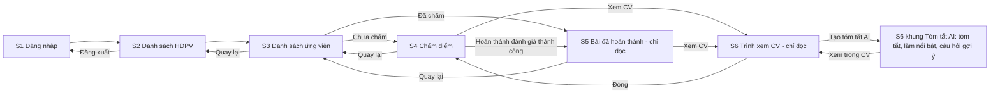

# Mockups chi tiết — App thực hiện phỏng vấn (MVP 2 ngày)

## Sources

- `aidlc/spaces/default/intents/261009-interview-execution-app/inception/user-stories/stories.md` — US1.1, US1.2, US2.1, US4.1, US5.1, US5.2, US6.1, US6.2, US6.3
- `aidlc/spaces/default/intents/261009-interview-execution-app/inception/requirements-analysis/requirements.md` — FR-A0, FR-A2, FR-A4..A7, BR-A1, BR-A2
- `aidlc/spaces/default/intents/261009-interview-execution-app/inception/practices-discovery/team-practices.md` — Flutter, TDD
- `aidlc/spaces/default/intents/261009-interview-execution-app/inception/refined-mockups/refined-mockups-questions.md` — Q1..Q6
- Xu hướng giao diện 2026 tham khảo: [Wavespace, 8 UI Design Trends in 2026](https://www.wavespace.agency/blog/ui-design-trends), [Dev.to, Web Design Trends 2026](https://dev.to/studiomeyer_io/web-design-trends-2026-what-actually-held-up-after-six-months-23p8). Nội dung được diễn giải lại để áp dụng vào bản thiết kế này.
- Không có wireframe hoặc user flow từ giai đoạn Ideation (classic bỏ rough-mockups); các màn hình được thiết kế trực tiếp từ user stories.

## Quyết định thiết kế (từ Q1..Q6)

| Câu hỏi | Quyết định |
|---|---|
| Q1 Thiết bị | Web (Flutter Web) trên máy tính để bàn, cộng điện thoại. Một mã nguồn, giao diện co giãn theo chiều rộng. |
| Q2 Bộ giao diện | Material 3 của Flutter, một màu chủ đạo, theo kiểu dáng xu hướng 2026 (xem bên dưới). |
| Q3 Chọn điểm | Hàng 5 nút số 1..5, bấm một chạm. |
| Q4 Dòng ứng viên | Dạng thẻ: giờ nổi bật bên trái, tên / mã / vị trí ở giữa, nhãn trạng thái bên phải; ứng viên đã chấm hiển thị nhạt hơn. |
| Q5 Truy cập | WCAG 2.1 AA ở mức cơ bản (xem `accessibility-checklist.md`). |
| Q6 Ngôn ngữ | Chỉ tiếng Việt; chuỗi chữ gom về một nơi. |
| Q7 Kết luận | Bắt buộc chọn một trong bốn: `Đạt` / `Loại` / `Cân nhắc` / `Khác` khi hoàn thành; là đề xuất cá nhân, không phải kết luận cuối. |
| Phông chữ (đợt 3) | Một họ sans-serif duy nhất, đồng nhất mọi màn hình (NFR-9). |
| Thuật ngữ (đợt 4) | "Nộp đánh giá / Nộp bài" đổi thành "Hoàn thành đánh giá" ở mọi màn hình, hộp thoại và thông báo. |
| Điểm trung bình (đợt 4) | Khối "Điểm trung bình" trên màn chấm điểm, tính ngay khi chọn điểm từng tiêu chí; cột "Điểm TB" trên danh sách ứng viên đã hoàn thành; server tính và lưu khi hoàn thành đánh giá. |
| Q8 Nhận xét | Vẫn tùy chọn, kể cả khi chọn `Loại` hoặc `Cân nhắc`. |
| Q9 Refer | Tối đa 1 vị trí khác kèm lý do ngắn tùy chọn; chỉ lưu đề xuất. Từ đợt 3: khối "Giới thiệu sang vị trí khác (tùy chọn)" chỉ hiện khi kết luận là `Khác`. |
| Q10 Danh sách vị trí refer | Lấy từ bảng Vị trí do script nạp; không có vị trí hiện tại của ứng viên. |
| Q11 Xem CV | PDF chỉ đọc trong app (màn S6), không tải/in/chia sẻ. |
| Q12 Dữ liệu cá nhân | Khối thông tin vẫn ẩn SĐT, ngày sinh, giới tính; CV hiển thị nguyên văn; mỗi lần xem CV ghi nhật ký. |
| Đợt 2: AI | Thêm khung Tóm tắt AI trong S6: tóm tắt, làm nổi bật kinh nghiệm / trình độ / chứng chỉ trong CV, câu hỏi gợi ý thêm. Tắt theo mặc định bằng cờ cấu hình; chỉ hỗ trợ, không chấm điểm hay quyết định. |

## Phong cách "xu hướng 2026" áp dụng

Dùng vừa đủ để giao diện hiện đại nhưng vẫn dễ đọc và dựng kịp trong 2 ngày:

1. **Material 3 làm nền.** Màu, chữ, độ bo góc theo Material 3; không tự dựng bộ thành phần riêng.
2. **Thẻ kiểu bento.** Danh sách HĐPV trên màn rộng xếp thành lưới thẻ có kích thước khác nhau; trên điện thoại là một cột.
3. **Header kính mờ nhẹ.** Thanh trên cùng bán trong suốt, mờ nền khi cuộn. Chỉ dùng cho thanh trên cùng và thẻ đăng nhập, không dùng cho vùng có nhiều chữ. Có lựa chọn dự phòng nền đặc (xem mục Truy cập).
4. **Chế độ sáng và tối** theo cài đặt hệ thống, cả hai đều đạt tương phản (đã tính, xem `design-system-mapping.md`).
5. **Chuyển động nhỏ có mục đích:** nút điểm nhún nhẹ khi chọn, thẻ trượt vào khi mở, thanh tiến độ chạy mượt. Tắt khi người dùng bật "giảm chuyển động".
6. **Khung xương (skeleton)** thay vòng quay khi tải danh sách.
7. **Một họ phông sans-serif duy nhất** cho mọi màn hình, hộp thoại, thông báo, trình xem CV (phần giao diện) và khung AI, đồng nhất giữa web và điện thoại (NFR-9). Trong bản HTML, trang CV giả lập cũng dùng cùng họ sans-serif; trong app thật, chữ bên trong tệp PDF của CV theo phông nhúng trong tệp.

## Điểm ngắt giao diện

| Tên | Chiều rộng | Bố cục |
|---|---|---|
| Điện thoại | dưới 768 px | Một cột, chuyển trang kiểu ngăn xếp |
| Máy tính bảng / cửa sổ hẹp | 768 đến 1024 px | Một cột rộng hơn, nội dung căn giữa tối đa 720 px |
| Máy tính để bàn | trên 1024 px | Lưới thẻ cho danh sách HĐPV; màn ứng viên và chấm điểm chia hai khung (danh sách bên trái, chi tiết bên phải) |

## Sơ đồ điều hướng



Văn bản thay thế: Đăng nhập → danh sách HĐPV → danh sách ứng viên → chấm điểm (nếu chưa chấm) hoặc xem bài đã hoàn thành (nếu đã chấm). Hoàn thành đánh giá thành công chuyển sang màn bài đã hoàn thành. Đăng xuất ở danh sách HĐPV.

---

## S1 — Đăng nhập (US1.1)

Điện thoại:

```
┌──────────────────────────────┐
│                              │
│         ◉  Phỏng vấn         │
│   Đăng nhập để bắt đầu       │
│                              │
│  Email                       │
│  ┌────────────────────────┐  │
│  │ ten@congty.vn          │  │
│  └────────────────────────┘  │
│  Mật khẩu                    │
│  ┌────────────────────────┐  │
│  │ ••••••••            👁 │  │
│  └────────────────────────┘  │
│                              │
│  ┌────────────────────────┐  │
│  │       Đăng nhập        │  │
│  └────────────────────────┘  │
│                              │
│  ⚠ Email hoặc mật khẩu       │
│    không đúng                │
└──────────────────────────────┘
```

Máy tính để bàn: thẻ kính mờ rộng 420 px đặt giữa màn hình, nền chuyển màu mềm; nội dung thẻ giống điện thoại.

| Phần tử | Mô tả |
|---|---|
| Email | Ô nhập, bàn phím email, kiểm tra định dạng khi rời ô |
| Mật khẩu | Ô nhập có nút hiện/ẩn mật khẩu |
| Đăng nhập | Nút chính; vô hiệu và hiện vòng tải trong lúc gửi |
| Thông báo lỗi | Dòng lỗi chung dưới nút, kèm biểu tượng, đọc được bằng trình đọc màn hình |

Trạng thái: mặc định; lỗi định dạng (viền đỏ + chữ dưới ô, không gửi request); đang gửi; sai thông tin ("Email hoặc mật khẩu không đúng"); tài khoản bị khóa ("Tài khoản đã bị khóa"); mất mạng ("Không kết nối được. Thử lại").

## S2 — Danh sách HĐPV của tôi (US1.2, US2.1)

Điện thoại:

```
┌──────────────────────────────┐
│ Hội đồng của tôi      [NV ▾] │  ← menu: Đăng xuất
├──────────────────────────────┤
│ ┌──────────────────────────┐ │
│ │ HD-0012        [Online]  │ │
│ │ Phỏng vấn CV BA đợt 3    │ │
│ │ 15/10/2026 · Phòng họp A │ │
│ │ ▓▓▓▓▓░░░░░  5/12 đã chấm │ │
│ └──────────────────────────┘ │
│ ┌──────────────────────────┐ │
│ │ HD-0015       [Offline]  │ │
│ │ Phỏng vấn CV DEV đợt 1   │ │
│ │ 16/10/2026 · Tầng 5      │ │
│ │ ░░░░░░░░░░  0/8 đã chấm  │ │
│ └──────────────────────────┘ │
└──────────────────────────────┘
```

Máy tính để bàn (lưới bento, 2 đến 3 cột, thẻ HĐPV gần ngày nhất rộng gấp đôi):

```
┌────────────────────────────────────────────────────────────────┐
│ ◉ Phỏng vấn            Hội đồng của tôi              [NV ▾]   │
├────────────────────────────────────────────────────────────────┤
│ ┌───────────────────────────────┐ ┌──────────────────────────┐ │
│ │ HD-0012            [Online]   │ │ HD-0015         [Offline]│ │
│ │ Phỏng vấn CV BA đợt 3         │ │ Phỏng vấn CV DEV đợt 1   │ │
│ │ 15/10/2026 · Phòng họp A      │ │ 16/10/2026 · Tầng 5      │ │
│ │ ▓▓▓▓▓░░░░░  5/12 đã chấm      │ │ ░░░░░░░░░░  0/8 đã chấm  │ │
│ └───────────────────────────────┘ └──────────────────────────┘ │
└────────────────────────────────────────────────────────────────┘
```

| Phần tử | Mô tả |
|---|---|
| Thẻ HĐPV | Mã, tên, ngày, hình thức (nhãn `Online`/`Offline`), địa điểm, thanh tiến độ "đã chấm / tổng" (chỉ tính ứng viên đã xác nhận lịch của chính tôi). Cả thẻ bấm được. |
| Menu người dùng | Hiển thị tên; mục "Đăng xuất" (US1.2) |

Trạng thái: đang tải (3 thẻ khung xương); có dữ liệu (sắp theo ngày tăng dần rồi theo mã); rỗng ("Bạn chưa được gán vào hội đồng phỏng vấn nào đang diễn ra"); lỗi mạng/server ("Không tải được danh sách" + nút Thử lại).

## S3 — Danh sách ứng viên của HĐPV (US4.1)

Điện thoại:

```
┌──────────────────────────────┐
│ ←  HD-0012 · CV BA đợt 3     │
│    5/12 đã chấm              │
├──────────────────────────────┤
│ ┌──────────────────────────┐ │
│ │ 08:30–09:00 Nguyễn Văn An│ │
│ │ 15/10/2026  UV-1021      │ │
│ │             CV BA · CNTT │ │
│ │               [Đã chấm ✓]│ │  ← nhạt hơn
│ └──────────────────────────┘ │
│ ┌──────────────────────────┐ │
│ │ 09:15–09:45 Trần Thị Bình│ │
│ │ 15/10/2026  UV-1034      │ │
│ │             CV BA · CNTT │ │
│ │             [Chưa chấm ●]│ │
│ └──────────────────────────┘ │
└──────────────────────────────┘
```

Máy tính để bàn (hai khung): trái là danh sách (rộng 400 px), phải là chi tiết ứng viên đang chọn (S4 hoặc S5). Khi chưa chọn ai, khung phải hiển thị "Chọn một ứng viên để bắt đầu".

```
┌───────────────────────────────┬──────────────────────────────────┐
│ ← HD-0012 · 5/12 đã chấm      │                                  │
│ ┌───────────────────────────┐ │  Chọn một ứng viên để bắt đầu    │
│ │ 08:30–09:00  Nguyễn Văn An│ │                                  │
│ │ 15/10/2026   UV-1021   [✓]│ │                                  │
│ ├───────────────────────────┤ │                                  │
│ │ 09:15–09:45  Trần Thị Bình│ │                                  │
│ │ 15/10/2026   UV-1034   [●]│ │                                  │
│ └───────────────────────────┘ │                                  │
└───────────────────────────────┴──────────────────────────────────┘
```

| Phần tử | Mô tả |
|---|---|
| Thẻ ứng viên | Giờ bắt đầu và kết thúc nổi bật bên trái; tên, mã ứng viên, vị trí (`job` và đơn vị) ở giữa; nhãn trạng thái bên phải |
| Nhãn trạng thái | `Chưa chấm` (chấm tròn, màu cam) hoặc `Đã chấm` (dấu tích, màu xanh) — luôn có chữ và biểu tượng, không chỉ màu |
| Cột Điểm TB | Chỉ với bài đã hoàn thành: nhãn "Điểm TB 3,8" (điểm trung bình các tiêu chí, một chữ số thập phân, dấu phẩy). Ứng viên chưa chấm không hiển thị nhãn này. |
| Nhãn kết luận | Chỉ khi đã hoàn thành: thêm nhãn `Đạt` (dấu tích), `Loại` (dấu gạch chéo), `Cân nhắc` (dấu hỏi) hoặc `Khác` (mũi tên chéo), luôn có chữ và biểu tượng |
| Thẻ đã chấm | Hiển thị nhạt hơn nhưng vẫn đạt tương phản; bấm để xem lại bài (S5) |
| Thứ tự | Giờ bắt đầu sớm đến muộn; cùng giờ thì mã nhỏ trước |
| Ngày giờ | Mỗi dòng ghi khung giờ `hh:mm – hh:mm` nổi bật và ngày `dd/mm/yyyy` chữ nhỏ ngay dưới, để khớp AC4.1.4; trình đọc màn hình đọc đầy đủ cả ngày và giờ. Ở bố cục hai khung chiều rộng 400 px, ngày vẫn giữ trên dòng thứ hai. |

Trạng thái: đang tải (khung xương); có dữ liệu; rỗng ("Chưa có ứng viên xác nhận lịch"); lỗi mạng/server (thông báo + Thử lại); HĐPV không còn `Inprogress` hoặc không được gán (thông báo "Hội đồng không còn mở" + nút về danh sách).

## S4 — Chấm điểm (US5.1, US5.2, US6.1, US6.2)

Điện thoại:

```
┌──────────────────────────────┐
│ ←  Nguyễn Văn An             │
├──────────────────────────────┤
│ UV-1021 · CV BA · Khối CNTT  │
│ 08:30–09:00 · Online         │
│ Kinh nghiệm: 4 năm           │
│ Trình độ: Đại học            │
│ [ 📄 Xem CV ]                │
├──────────────────────────────┤
│ TC01 · Kiến thức chuyên môn  │
│ [1] [2] [3] [4] [5]          │
│ TC02 · Giao tiếp             │
│ [1] [2] [3] [4] [5]          │
│ TC03 · Giải quyết vấn đề     │
│ [1] [2] [3] [4] [5]          │
│  ...                         │
│ Điểm trung bình      3,7 / 5 │
│ tạm tính 3/5 tiêu chí đã chọn│
├──────────────────────────────┤
│ Kết luận (đề xuất của bạn) * │
│ [ ✓ Đạt   ]  [ ✕ Loại   ]    │
│ [ ? Cân nhắc] [ ↗ Khác  ]    │
│ ┄ chỉ hiện khi chọn "Khác" ┄ │
│ Giới thiệu sang vị trí khác  │
│ (tùy chọn)                   │
│ [ Không refer            ▾ ]│
│ Lý do refer (tùy chọn)       │
│ [                          ] │
│ Nhận xét (không bắt buộc)    │
│ ┌────────────────────────┐   │
│ │                        │   │
│ └────────────────────────┘   │
│                    0/2000    │
├──────────────────────────────┤
│ 3/5 tiêu chí · thiếu kết luận│
│ [ Hoàn thành đánh giá ]      │  ← thanh dưới cố định
└──────────────────────────────┘
```

Máy tính để bàn: khung phải của hai khung; thông tin ứng viên là thẻ ở đầu, tiêu chí là các thẻ bento hai cột, thanh hoàn thành đánh giá cố định ở đáy khung.

| Phần tử | Mô tả |
|---|---|
| Thẻ thông tin ứng viên | Mã, tên, vị trí, kinh nghiệm, trình độ, khung giờ, hình thức và địa điểm. Không hiển thị số điện thoại, ngày sinh, giới tính. |
| Tiêu chí | Mã và tên tiêu chí; hàng 5 nút điểm (vùng chạm tối thiểu 48 px); nút đã chọn tô màu chủ đạo và có dấu tích để không chỉ dựa vào màu |
| Tiêu chí thiếu | Khi bấm Hoàn thành đánh giá mà còn thiếu, tiêu chí đó viền đỏ + chữ "Chưa chọn điểm" và màn cuộn tới tiêu chí thiếu đầu tiên |
| Nhận xét | Ô nhiều dòng, bộ đếm `n/2000`, chặn nhập quá 2000 |
| Thanh hoàn thành đánh giá | "đã chấm / tổng tiêu chí" và nút Hoàn thành đánh giá. Nút ở trạng thái khóa khi còn thiếu điểm hoặc chưa chọn kết luận; bấm vào nút khóa sẽ đánh dấu mục thiếu và đưa tiêu điểm tới mục thiếu đầu tiên. |
| Nút Xem CV | Trong thẻ thông tin ứng viên; mở màn S6. Hiển thị "Chưa có CV" và không bấm được khi ứng viên không có CV. |
| Khối Điểm trung bình | Nằm ngay dưới danh sách tiêu chí. Hiển thị số lớn "x,x / 5" và dòng phụ. Cập nhật ngay mỗi lần chọn hoặc đổi điểm một tiêu chí. Trước khi chọn đủ: dòng phụ "Tạm tính theo n/N tiêu chí đã chọn"; chưa chọn điểm nào: hiển thị "—" và "Chưa chọn điểm nào"; chọn đủ: "Trung bình N tiêu chí". Chú thích "Chỉ để tham khảo, không thay thế kết luận của bạn". Ở bài đã hoàn thành: hiển thị điểm đã lưu, chỉ đọc. |
| Khối Kết luận | Bắt buộc. Bốn lựa chọn `Đạt` / `Loại` / `Cân nhắc` / `Khác`, chọn một; mỗi lựa chọn có biểu tượng và chữ riêng, lựa chọn đã chọn có vòng tròn đặc. Điện thoại xếp hai hàng hai cột, máy tính để bàn xếp một hàng. Chú thích: "Đề xuất của bạn, không phải kết luận cuối". |
| Khối Giới thiệu sang vị trí khác (tùy chọn) | **Chỉ hiện khi chọn kết luận `Khác`.** Ô chọn (mặc định "Không refer", danh sách trừ vị trí hiện tại) và ô lý do tối đa 500 ký tự, chỉ bật khi đã chọn vị trí. Đổi sang kết luận khác thì khối ẩn và giá trị đã nhập bị xóa. |

Trạng thái: đang tải (khung xương); chưa có tiêu chí ("Chưa cấu hình tiêu chí", không cho chấm); đang nhập; đủ điểm (nút Hoàn thành đánh giá bật); đang hoàn thành (nút vô hiệu, vòng tải); hoàn thành lỗi mạng (giữ dữ liệu, thông báo "Chưa hoàn thành được" + Thử lại với cùng mã chống gửi trùng); ứng viên không còn hợp lệ hoặc HĐPV không còn mở (thông báo + về danh sách); đã có bài hoàn thành (chuyển sang S5).

## S5 — Bài đã hoàn thành, chỉ đọc (US6.3)

```
┌──────────────────────────────┐
│ ←  Nguyễn Văn An             │
│ ✓ Đã hoàn thành 09:12 15/10  │
├──────────────────────────────┤
│ UV-1021 · CV BA · Khối CNTT  │
├──────────────────────────────┤
│ TC01 · Kiến thức chuyên môn  │
│ [1] [2] [3] [●4] [5]  (khóa) │
│ TC02 · Giao tiếp             │
│ [1] [2] [●3] [4] [5]  (khóa) │
│  ...                         │
│ Điểm trung bình      3,8 / 5 │
│ Kết luận của bạn: [↗ Khác]   │
│ Refer: CV DEV · Khối CNTT    │
│ Lý do: "Mạnh về lập trình"   │
│ Nhận xét                     │
│ "Trả lời tốt, cần thêm ví dụ"│
│ [ 📄 Xem CV ]                │
└──────────────────────────────┘
```

| Phần tử | Mô tả |
|---|---|
| Biểu ngữ | "Đã hoàn thành lúc …" với dấu tích; không có nút sửa hoặc hoàn thành lại |
| Điểm | Hiển thị điểm đã chọn dạng chỉ đọc, giữ nguyên thang |
| Tiêu chí đã ngừng dùng | Vẫn hiển thị cùng điểm đã chấm |

## S6 — Trình xem CV (US5.5)

Mở từ nút Xem CV ở S4 hoặc S5. Điện thoại: toàn màn hình. Máy tính để bàn: lớp phủ rộng 70% chiều ngang bên phải khung chi tiết.

```
┌──────────────────────────────┐
│ ✕  CV · Nguyễn Văn An        │
│    UV-1021 · Chỉ đọc         │
├──────────────────────────────┤
│  ┌────────────────────────┐  │
│  │                        │  │
│  │   (nội dung CV, PDF)   │  │
│  │                        │  │
│  │                        │  │
│  └────────────────────────┘  │
├──────────────────────────────┤
│  [−]  Trang 1/2  [+]   [‹][›]│
└──────────────────────────────┘
```

| Phần tử | Mô tả |
|---|---|
| Thanh trên | Nút Đóng, tên ứng viên, mã, nhãn "Chỉ đọc" |
| Vùng xem | Trình xem PDF nhúng; cuộn dọc, phóng to / thu nhỏ, chuyển trang |
| Quyền | Không có nút tải xuống, in hay chia sẻ |
| Cảnh báo | Chú thích nhỏ: "CV chứa thông tin cá nhân. Mỗi lần xem được ghi nhật ký." |

Trạng thái: đang tải (khung xương trong vùng xem); hiển thị; lỗi ("Không mở được CV" + nút Thử lại); hết hạn liên kết (tự xin liên kết mới một lần, nếu vẫn lỗi thì hiện lỗi trên); chưa có CV (nút ở S4/S5 không bấm được, không mở S6).

### S6 — Khung Tóm tắt AI (US5.6, US5.7; đợt 2)

Máy tính để bàn: trình xem CV rộng 94%, chia hai cột — CV bên trái, khung Tóm tắt AI bên phải (rộng 380 px). Điện thoại: hai tab "CV" và "✨ Tóm tắt AI" trên cùng. Bản HTML `mockups-preview.html` có đủ các trạng thái bên dưới (dùng ô "Mô phỏng lỗi AI" và "Tắt tính năng AI" trên thanh công cụ).

Máy tính để bàn, đã tạo xong:

```
┌──────────────────────────────────┬─────────────────────────────────┐
│ ✕  CV · Nguyễn Văn An            │ Tóm tắt AI [AI]                 │
│    UV-1021 · Chỉ đọc             │ ┌─────────────────────────────┐ │
├──────────────────────────────────┤ │ Do AI tạo từ nội dung CV... │ │
│  ┌────────────────────────────┐  │ └─────────────────────────────┘ │
│  │ Nguyễn Văn An              │  │ Tóm tắt                         │
│  │ ...                        │  │ ┌─────────────────────────────┐ │
│  │ KINH NGHIỆM LÀM VIỆC       │  │ │ Chuyên viên phân tích...    │ │
│  │ • ▔▔2022 – nay: Chuyên ▔▔KN│  │ └─────────────────────────────┘ │
│  │ • ▔▔2019 – 2022: ...  ▔▔KN │  │ [Kinh nghiệm KN][Trình độ TĐ]   │
│  │ HỌC VẤN ┄┄Đại học┄┄ TĐ     │  │ [Chứng chỉ CC]                  │
│  │ CHỨNG CHỈ ┈CBAP┈ CC        │  │ Kinh nghiệm (KN)                │
│  └────────────────────────────┘  │ ┌─────────────────────────────┐ │
│                                  │ │ Chuyên viên PTNV · Cty ABC  │ │
│                                  │ │ 2022 – nay                  │ │
│                                  │ │ Xem trong CV (trang 1)      │ │
│                                  │ └─────────────────────────────┘ │
│                                  │ Câu hỏi gợi ý thêm              │
│                                  │ [Kinh nghiệm] 1. Ở Công ty ABC..│
│                                  │   Dựa trên: Công ty ABC, 2022.. │
│  [−] 100% [+]  [‹] Trang 1/2 [›] │ ☑ Làm nổi bật trong CV [Tạo lại]│
└──────────────────────────────────┴─────────────────────────────────┘
```

| Phần tử | Mô tả |
|---|---|
| Lưu ý AI | Luôn hiển thị đầu khung: "Do AI tạo từ nội dung CV, có thể sai sót, chỉ để tham khảo. Không dùng để chấm điểm hay quyết định. Mỗi lần tạo được ghi nhật ký." |
| Tóm tắt | Đoạn ngắn tối đa 800 ký tự |
| Nhóm KN / TĐ / CC | Mỗi mục có tiêu đề, thời gian (nếu có) và liên kết **Xem trong CV (trang n)** chuyển tới trang và nhấn mạnh đoạn trích bằng khung viền trong 2 giây |
| Làm nổi bật trong CV | Công tắc; khi bật, đoạn trích trong CV được tô nền nhạt, gạch chân khác kiểu (KN gạch liền, TĐ gạch nét đứt, CC gạch chấm) và có nhãn chữ KN, TĐ, CC phía trên |
| Câu hỏi gợi ý thêm | Danh sách đánh số 3 đến 6 câu; mỗi câu có nhãn loại và dòng "Dựa trên: <mục nguồn>" |
| Tạo lại | Gọi AI lại, bỏ qua kết quả đã lưu |
| Thời điểm | "Kết quả đã lưu lúc <giờ>" |

Trạng thái khung AI:

| Trạng thái | Hiển thị |
|---|---|
| Tắt (cờ cấu hình) | "Tính năng AI đang tắt. Liên hệ người vận hành để bật." Không có nút tạo. |
| Chưa tạo | Mô tả ngắn, lưu ý AI và nút **✨ Tạo tóm tắt AI** |
| Đang tạo | Khung xương và dòng "Đang tạo tóm tắt…" (thông báo trực tiếp cho trình đọc màn hình) |
| Đã tạo | Đầy đủ các phần ở bảng trên |
| Lỗi | Biểu ngữ "Không tạo được tóm tắt AI. CV vẫn xem được bình thường." + nút Thử lại |
| CV dạng ảnh | "CV dạng ảnh, chưa hỗ trợ tóm tắt" |
| Quá giới hạn lần gọi | "Bạn tạo tóm tắt quá nhiều lần. Thử lại sau" |
| CV chưa mở được | "Chưa mở được CV nên chưa thể tạo tóm tắt AI" |

Quy tắc hiển thị: AI không tự điền điểm, kết luận, nhận xét hay refer; các trường đó ở S4 chỉ chứa những gì người phỏng vấn nhập. Câu hỏi gợi ý không được lưu cùng đánh giá.

## Hộp thoại và thông báo

| Mã | Khi nào | Nội dung | Hành động |
|---|---|---|---|
| D1 | Bấm Hoàn thành đánh giá khi đủ điểm | "Sau khi hoàn thành sẽ không sửa được. Hoàn thành đánh giá cho Nguyễn Văn An?" | `Hoàn thành đánh giá` (chính) / `Kiểm tra lại` |
| D2 | Rời S4 khi đã nhập mà chưa hoàn thành | "Dữ liệu chưa lưu sẽ mất. Rời khỏi màn này?" | `Ở lại` (mặc định) / `Rời đi` |
| D3 | API trả `401` | Chuyển về S1 kèm thông báo "Phiên đăng nhập đã hết hạn" | tự động |
| B1 | Lỗi mạng khi tải | Biểu ngữ "Không kết nối được" + Thử lại | `Thử lại` |
| B3 | Không mở được CV | Biểu ngữ "Không mở được CV" trong S6 | `Thử lại` / `Đóng` |
| B4 | Không tạo được tóm tắt AI | Biểu ngữ "Không tạo được tóm tắt AI. CV vẫn xem được bình thường." trong khung AI | `Thử lại` |
| B2 | Hoàn thành đánh giá thành công | Thông báo ngắn "Đã hoàn thành đánh giá", rồi chuyển S5 | tự đóng sau 3 giây |

## Truy vết story → màn hình

| Story | Màn hình |
|---|---|
| US1.1 | S1, D3 |
| US1.2 | S2 (menu Đăng xuất) |
| US2.1 | S2 |
| US4.1 | S3 |
| US5.1, US5.2 | S4 |
| US5.3 | S4 (khối Kết luận), S5 (kết luận chỉ đọc), S3 (nhãn kết luận trên thẻ) |
| US5.4 | S4 (khối Refer), S5 (refer chỉ đọc) |
| US5.5 | S4, S5 (nút Xem CV), S6, B3 |
| US5.8 | S4 (khối Điểm trung bình, cập nhật khi chọn điểm), S5 (điểm đã lưu), S3 (nhãn Điểm TB trên thẻ) |
| US5.6 | S6 khung Tóm tắt AI, làm nổi bật trong CV |
| US5.7 | S6 khung Tóm tắt AI, nhóm Câu hỏi gợi ý thêm |
| US7.4 | Không có giao diện; trạng thái "AI đang tắt" ở khung AI của S6 |
| US8.1 | Mọi màn hình: một họ phông sans-serif; chữ tiếng Việt |
| US8.2 | Mọi màn hình: ba điểm ngắt (dưới 768, 768 đến 1024, trên 1024 px) |
| US8.3 | S3 + S4/S5 hai khung trên máy tính để bàn |
| US8.4 | Mọi màn hình: chế độ sáng và tối theo hệ thống |
| US8.5 | Mọi màn hình: vùng chạm, nhãn, bàn phím, không chỉ dùng màu |
| US8.6 | S2, S3, S6: khung xương khi tải; giảm chuyển động |
| US6.1 | S4, D1, B2, S5 |
| US6.2 | S4 (nút vô hiệu khi đang hoàn thành, thử lại cùng mã chống gửi trùng) |
| US6.3 | S5 |
| US7.1, US7.2, US7.3 | Không có giao diện; người vận hành dùng script nạp dữ liệu |

## Assumptions & Open Questions

- **[assumption]** Tên tiêu chí, ví dụ "Kiến thức chuyên môn", "Giao tiếp", "Giải quyết vấn đề", chỉ là dữ liệu minh họa; tiêu chí thật lấy từ dữ liệu nạp (US7.2).
- **[assumption]** Màn hai khung trên máy tính để bàn là cách hiển thị khác của cùng luồng S3 → S4/S5, không thêm chức năng. Nếu thiếu thời gian, có thể dùng chuyển trang như điện thoại ở mọi kích thước mà không đổi story.
- **[assumption]** Màu chủ đạo là xanh chàm (indigo); PO có thể đổi mã màu mà không ảnh hưởng cấu trúc.
- **Open question:** Có cần hiển thị tên người dùng và vai trò ở menu S2 không; hiện chỉ hiển thị tên (từ phản hồi đăng nhập).
- **[assumption]** Bản xem trước HTML (`mockups-preview.html`) là tài liệu hỗ trợ xem giao diện, không thuộc 5 tệp bắt buộc của stage. Màn S6 trong bản HTML dùng một khung giả lập nội dung CV, không phải tệp PDF thật.
- **[assumption]** Nội dung AI trong `mockups-preview.html` (tóm tắt, mục KN / TĐ / CC, câu hỏi) là dữ liệu giả lập, không gọi mô hình thật; chất lượng và độ chính xác của AI thật chưa được đánh giá.
- **[assumption]** Khung Tóm tắt AI luôn xuất hiện trong S6 kể cả khi tính năng tắt, để người phỏng vấn biết vì sao chưa dùng được; nếu PO muốn ẩn hẳn khi tắt thì bỏ trạng thái "Tắt".
- **Open question:** Tài liệu nguồn Phase 2 (mục 11.2) ghi không dùng AI phân tích ứng viên trong MVP khi chưa có cơ sở pháp lý, consent và rà soát thiên lệch; nhà cung cấp AI chưa chọn (OQ-AI-1..4 trong `requirements.md`).
- **[assumption]** Mức ưu tiên của US5.4 (Refer) và US5.5 (Xem CV) là Should Have, đề xuất để có điểm cắt khi thiếu thời gian; PO xác nhận khi duyệt.
- **[assumption]** Nút khóa Hoàn thành đánh giá vẫn bấm được để đánh dấu mục thiếu (trạng thái `aria-disabled`), thống nhất với AC5.2.1.
