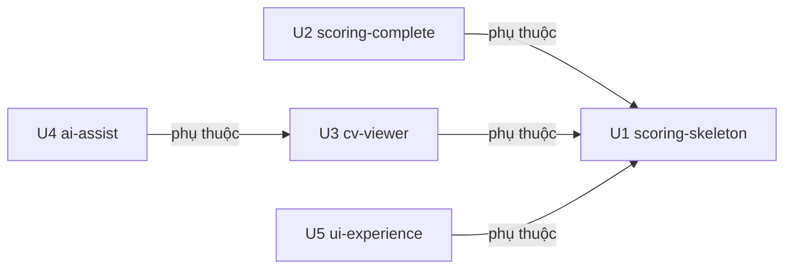

# Phụ thuộc giữa các Unit

## Sources

- `aidlc/spaces/default/intents/261009-interview-execution-app/inception/units-generation/unit-of-work.md`
- `aidlc/spaces/default/intents/261009-interview-execution-app/inception/domain-design/components.md` — phụ thuộc giữa các khối
- `aidlc/spaces/default/intents/261009-interview-execution-app/inception/domain-design/decisions.md` — ADR-002, ADR-003, ADR-006

Tài liệu này chỉ mô tả cấu trúc phụ thuộc. Thứ tự làm, đường găng và đường cắt phạm vi do Delivery Planning quyết định.

## Khối phụ thuộc (nguồn chính thức)

```yaml
units:
  - name: u1-scoring-skeleton
    kind: service
    depends_on: []
  - name: u2-scoring-complete
    kind: service
    depends_on: [u1-scoring-skeleton]
  - name: u3-cv-viewer
    kind: service
    depends_on: [u1-scoring-skeleton]
  - name: u4-ai-assist
    kind: service
    depends_on: [u3-cv-viewer]
  - name: u5-ui-experience
    kind: ui
    depends_on: [u1-scoring-skeleton]
```

## Sơ đồ



Văn bản thay thế: U2, U3 và U5 cùng phụ thuộc U1; U4 phụ thuộc U3. Không có vòng phụ thuộc.

## Cạnh phụ thuộc và lý do

| Unit | Phụ thuộc | Lý do |
|---|---|---|
| U2 scoring-complete | U1 | Mở rộng phiếu chấm, API hoàn thành đánh giá và các màn S3, S4 do U1 dựng; cần thực thể InterviewEvaluation và EvaluationScore |
| U3 cv-viewer | U1 | Cần chính sách truy cập của InterviewCatalog, xác thực của IdentityAccess, DataImport và màn S4 để đặt nút Xem CV |
| U4 ai-assist | U3 | Lấy văn bản CV và cvHash từ CandidateDocuments (ADR-006); khung AI nằm trong trình xem CV S6 |
| U5 ui-experience | U1 | Áp dụng chủ đề và bố cục chung lên khung app và các màn hình của U1 |

## Điểm tích hợp

| Giữa | Loại | Nội dung |
|---|---|---|
| U1 ↔ U2 | Dữ liệu dùng chung + API | U2 thêm cột `ketLuan`, `referMaViTri`, `referLyDo`, `diemTrungBinh` vào InterviewEvaluation; mở rộng API hoàn thành đánh giá; thêm API tóm tắt đánh giá theo HĐPV; thêm truy vấn chính sách vị trí của InterviewCatalog |
| U1 ↔ U3 | API nội bộ + dữ liệu | U3 gọi truy vấn chính sách truy cập của InterviewCatalog; DataImport của U1 thêm bước ghi `cvPath` qua CandidateDocuments |
| U3 ↔ U4 | API nội bộ | U4 gọi CandidateDocuments lấy văn bản CV và cvHash sau kiểm quyền |
| U1 ↔ U5 | Mã client dùng chung | U5 đặt chủ đề, phông, điểm ngắt và thành phần dùng chung cho các màn hình của U1 |
| U2, U3, U4 ↔ U5 | Mã client dùng chung | Màn hình mới dùng chủ đề và thành phần chung của U5 |
| Tất cả | Hạ tầng dùng chung | Một backend Node.js, một app Flutter, một Oracle XE (Q2 = A) |

Hợp đồng chi tiết của các điểm tích hợp (tên API, dữ liệu vào ra, mã lỗi) thuộc Contract Design.

## Khả năng làm song song

- **Không phụ thuộc gì:** U1.
- **Sau U1, ba Unit không phụ thuộc nhau:** U2, U3, U5 có thể làm song song.
- **Sau U3:** U4.
- Các thứ tự tô-pô hợp lệ, ví dụ: U1 → U2 → U3 → U4 → U5; U1 → U5 → U3 → U2 → U4; U1 → U3 → U4 → U2 → U5. Delivery Planning chọn thứ tự.
- Lưu ý khi làm song song: U2, U3, U4, U5 cùng sửa app Flutter, và U2, U3 cùng sửa module Evaluation hoặc InterviewCatalog. Ranh giới module giảm xung đột nhưng không loại bỏ.

## Walking skeleton

- U1 `scoring-skeleton` là Unit đầu tiên trong mọi thứ tự tô-pô (không phụ thuộc gì, mọi Unit khác phụ thuộc trực tiếp hoặc gián tiếp vào nó).
- U1 chạy được một mình: có nạp dữ liệu, backend, Oracle và app đủ để đăng nhập, chọn HĐPV, chấm và hoàn thành một ứng viên, rồi kiểm tra bản ghi trong DB. Không cần Unit nào khác.
- Delivery Planning chốt lệnh xác minh đầu cuối và nội dung demo của skeleton.

## Assumptions & Open Questions

- **[assumption]** U5 phụ thuộc U1 chứ không ngược lại, nên U1 dùng giao diện mức tối thiểu; nếu PO muốn skeleton đã có phông và bố cục chuẩn thì một phần U5 cần chuyển vào U1.
- **Open question:** Không có.
