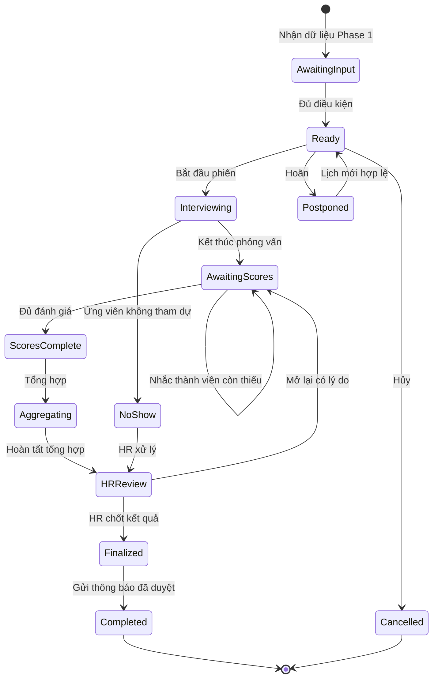
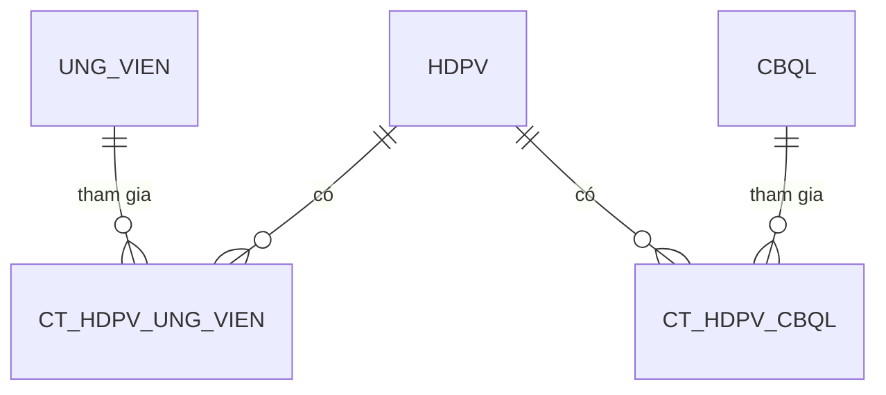

# Product concept — Phase 2: App thực hiện phỏng vấn

## 1. Tóm tắt ý tưởng và mục tiêu

Phase 2 bắt đầu khi **HĐPV (Hội đồng phỏng vấn)** đã được thiết lập ở Phase 1, lịch đã được xác nhận và ứng viên cùng các bên tham gia đã chấp nhận. Phase 2 cung cấp một không gian làm việc thống nhất để:

- người phỏng vấn nắm lịch, truy cập đúng phần hồ sơ được phép xem và thực hiện phỏng vấn;
- từng thành viên HĐPV chấm điểm, ghi nhận xét và đưa ra khuyến nghị độc lập trên app;
- hệ thống theo dõi mức độ hoàn thành, nhắc việc và tổng hợp kết quả khi đủ điều kiện;
- Recruiter/HR review, xử lý chênh lệch và chốt kết luận cuối;
- gửi thông báo phù hợp sau khi kết quả đã được phê duyệt.

Mục tiêu là rút ngắn thời gian từ lúc phỏng vấn đến lúc có kết luận, chuẩn hóa chất lượng đánh giá, giảm thất lạc dữ liệu và bảo đảm quyết định có thể truy vết. **Điểm/khuyến nghị cá nhân là đầu vào tham khảo; kết luận tuyển dụng cuối cùng thuộc quyền chốt của Recruiter/HR theo chính sách doanh nghiệp.**

## 2. Phạm vi

| In scope — Phase 2 | Out of scope |
|---|---|
| Nhận bàn giao hồ sơ HĐPV đủ điều kiện từ Phase 1 | Tạo mới HĐPV, thiết kế hội đồng hoặc gán thành viên ban đầu |
| Hiển thị lịch/agenda và thông tin phỏng vấn theo phân quyền | Mời ứng viên/CBQL lần đầu và thu thập chấp nhận lịch |
| Hỗ trợ buổi phỏng vấn trực tiếp hoặc qua liên kết họp | Quản trị nguồn ứng viên, job posting, screening trước phỏng vấn |
| Scorecard, ghi chú, lưu nháp, nộp và khóa đánh giá | Offer, onboarding, background check sau kết quả |
| Theo dõi hoàn thành, nhắc việc và escalation | Thay thế nền tảng video conference hoặc ghi âm/ghi hình mặc định |
| Tổng hợp điểm/nhận xét/khuyến nghị Pass, Fail, Reserve | Tự động ra quyết định tuyển dụng không có HR review |
| HR review, chốt kết quả, notification/email sau duyệt | Xây dựng/cấu hình bộ tiêu chí gốc nếu đó là chức năng quản trị riêng |
| Xử lý ngoại lệ phát sinh trong lúc thực hiện Phase 2 | Mở rộng ngược sang chức năng setup của Phase 1 |

Phase 1 chỉ được nhắc như nguồn đầu vào và nơi xử lý thay đổi cấu hình/lịch khi cần; tài liệu này không thiết kế chức năng Phase 1.

## 3. Actor/persona, vai trò và quyền

> **Phân biệt thuật ngữ:** CBQL (cán bộ quản lý) là chức danh/quản lý nghiệp vụ và có thể được mời phỏng vấn, nhưng không mặc nhiên là thành viên HĐPV. Chỉ người được gán vai trò thành viên HĐPV trong hồ sơ cụ thể mới có quyền chấm điểm hồ sơ đó.

| Actor | Mục tiêu chính | Quyền trong Phase 2 |
|---|---|---|
| Recruiter/HR | Điều phối, bảo đảm đủ đánh giá, review và chốt kết quả | Xem tiến độ; xử lý ngoại lệ; yêu cầu bổ sung/mở lại theo quyền; xem tổng hợp; chốt Pass/Fail/Reserve; duyệt nội dung gửi ứng viên |
| Chủ tịch HĐPV | Điều hành phiên phỏng vấn và hỗ trợ thống nhất chuyên môn | Quyền của thành viên; theo dõi tình trạng hoàn thành của hội đồng; đề nghị thảo luận/giải trình khi chênh lệch; không tự thay thế quyền chốt của HR nếu chính sách không quy định |
| Thành viên HĐPV | Phỏng vấn và đánh giá theo tiêu chí được giao | Xem lịch và phần hồ sơ được cấp quyền; ghi chú; lưu nháp; submit đánh giá cá nhân; xem thông tin tổng hợp theo chính sách blind scoring |
| CBQL không thuộc HĐPV | Theo dõi hoặc tham gia theo nhu cầu nghiệp vụ | Chỉ xem/tham gia ở phạm vi được cấp; không được chấm điểm hoặc xem dữ liệu nhạy cảm nếu chưa được gán vai trò |
| Ứng viên | Tham gia đúng lịch và nhận thông tin phù hợp | Xem lịch, hướng dẫn, địa điểm/link họp; xác nhận tham gia/check-in nếu có; nhận cập nhật hoãn/hủy và kết quả đã được HR duyệt; không xem scorecard/nhận xét nội bộ |
| Hệ thống | Điều phối luồng và bảo đảm tính toàn vẹn | Kiểm tra điều kiện; autosave; khóa phiên bản; nhắc việc/escalation; tổng hợp; ghi audit log; gửi notification/email theo trạng thái và mẫu đã duyệt |

Quyền chi tiết cần áp dụng theo từng HĐPV, ứng viên, vị trí tuyển dụng và phạm vi tổ chức; không chỉ dựa trên chức danh toàn cục.

## 4. Đầu vào bắt buộc từ Phase 1 và điều kiện chuyển Phase 2

### 4.1. Đầu vào bắt buộc

- Mã HĐPV, vị trí tuyển dụng, vòng phỏng vấn và đơn vị tuyển dụng.
- Danh sách ứng viên thuộc phiên/vòng phỏng vấn và định danh hồ sơ tương ứng.
- Thời gian, múi giờ, hình thức, địa điểm hoặc liên kết họp hợp lệ.
- Danh sách Chủ tịch, thành viên HĐPV; vai trò, quyền và tiêu chí được phân công của từng người.
- Trạng thái chấp nhận lịch của ứng viên và các thành viên bắt buộc.
- Scorecard/bộ tiêu chí đã được phê duyệt cho vị trí/vòng, gồm thang điểm, trọng số, trường bắt buộc và quy tắc N/A.
- Deadline hoàn thành đánh giá; lịch nhắc và tuyến escalation tối thiểu.
- Chính sách hiển thị hồ sơ, blind scoring, quyền xem nhận xét và quyền mở lại đánh giá.
- Mẫu notification/email, ngôn ngữ giao tiếp và thông tin liên hệ hỗ trợ.

### 4.2. Definition of Ready — đủ điều kiện sang Phase 2

Một hồ sơ HĐPV chỉ ở trạng thái **Sẵn sàng phỏng vấn** khi đồng thời thỏa mãn:

1. lịch ở trạng thái đã xác nhận, chưa hủy/hoãn và thời gian/múi giờ không mâu thuẫn;
2. ứng viên và toàn bộ người tham gia bắt buộc đã chấp nhận theo chính sách;
3. có ít nhất số lượng thành viên hợp lệ tối thiểu, có Chủ tịch nếu nghiệp vụ yêu cầu;
4. scorecard đã được gắn và đóng phiên bản để dùng cho phiên này;
5. hồ sơ ứng viên cần thiết đã sẵn sàng và quyền truy cập đã được tính;
6. deadline, tuyến nhắc việc và HR phụ trách đã xác định;
7. không có lỗi tích hợp chặn truy cập lịch, hồ sơ hoặc scorecard.

Nếu dữ liệu bàn giao thiếu hoặc bị thay đổi không hợp lệ, Phase 2 hiển thị trạng thái **Chờ bổ sung đầu vào** và trả lỗi có nguyên nhân cho Recruiter/HR; hệ thống không tự suy đoán thành viên, lịch hay tiêu chí.

## 5. Luồng nghiệp vụ end-to-end và lifecycle

### 5.1. Happy path

1. **Tiếp nhận:** Hệ thống nhận hồ sơ đủ điều kiện từ Phase 1, tạo phiên bản scorecard cho từng thành viên và đưa phiên về **Sẵn sàng phỏng vấn**.
2. **Trước buổi phỏng vấn:** CBQL/HĐPV và ứng viên nhận thông tin lịch; người phỏng vấn xem agenda, phạm vi hồ sơ và tiêu chí được giao.
3. **Thực hiện:** Chủ tịch/HĐPV bắt đầu phiên; ứng viên tham gia. Hệ thống ghi nhận trạng thái tham dự/check-in nếu được sử dụng.
4. **Đánh giá cá nhân:** Mỗi thành viên ghi chú, chấm tiêu chí, chọn Pass/Fail/Reserve và lưu nháp. Đánh giá của người khác được ẩn trước submit nếu bật blind scoring.
5. **Nộp đánh giá:** App kiểm tra trường bắt buộc, cảnh báo dữ liệu thiếu/mâu thuẫn, sau đó submit và khóa phiên bản cá nhân.
6. **Theo dõi hoàn thành:** Hệ thống kiểm tra các thành viên bắt buộc. Nếu còn thiếu, gửi nhắc việc/escalation cho đúng đối tượng đến deadline.
7. **Tổng hợp:** Khi đủ đánh giá hợp lệ hoặc HR áp dụng ngoại lệ có lý do, hệ thống tính tổng hợp theo cấu hình, chỉ ra chênh lệch lớn và gom nhận xét.
8. **HR review:** Recruiter/HR xem điểm cá nhân, tổng hợp, cảnh báo và biên bản giải trình; có thể yêu cầu bổ sung/mở lại đánh giá theo quyền.
9. **Chốt:** HR chọn kết luận cuối Pass/Fail/Reserve, nhập lý do bắt buộc nếu khác khuyến nghị tổng hợp và duyệt nội dung truyền thông.
10. **Thông báo và kết thúc:** Hệ thống gửi notification/email đúng đối tượng. Hồ sơ chuyển **Đã kết thúc**, dữ liệu và audit log được lưu theo chính sách.

### 5.2. Trạng thái lifecycle đề xuất

| Trạng thái | Ý nghĩa | Chuyển trạng thái chính |
|---|---|---|
| Chờ bổ sung đầu vào | Chưa đạt Definition of Ready | Sang Sẵn sàng khi lỗi đầu vào được khắc phục; sang Đã hủy nếu phiên bị hủy |
| Sẵn sàng phỏng vấn | Đã nhận đủ đầu vào, chờ đến phiên | Sang Đang phỏng vấn, Đã hoãn hoặc Đã hủy |
| Đang phỏng vấn | Phiên đang diễn ra | Sang Chờ đánh giá; hoặc No-show/Đã hoãn/Đã hủy theo ngoại lệ |
| Chờ đánh giá | Đã phỏng vấn, còn đánh giá bắt buộc chưa submit | Sang Đủ đánh giá; có thể quay về Đang phỏng vấn nếu phiên tiếp tục |
| Đủ đánh giá | Đã đủ điều kiện tổng hợp | Sang Đang tổng hợp |
| Đang tổng hợp | Hệ thống tạo kết quả tổng hợp và kiểm tra cảnh báo | Sang Chờ HR review |
| Chờ HR review | HR xem xét và xử lý chênh lệch/bổ sung | Sang Đã chốt; hoặc quay lại Chờ đánh giá khi mở lại |
| Đã chốt | Kết luận cuối đã lưu, chờ duyệt/gửi thông báo | Sang Đã kết thúc; chỉ mở lại theo quyền đặc biệt |
| Đã kết thúc | Đã hoàn tất truyền thông và khóa nghiệp vụ | Trạng thái kết thúc |
| Đã hoãn / Đã hủy / No-show | Nhánh ngoại lệ có lý do và audit | Hoãn có thể trở lại Sẵn sàng sau khi Phase 1 cập nhật lịch; Hủy là kết thúc; No-show do HR xử lý theo chính sách |

**Diễn giải thay thế:** nhận đầu vào → sẵn sàng → phỏng vấn → chờ/đủ đánh giá → tổng hợp → HR review → chốt → thông báo → kết thúc; các nhánh hoãn, hủy và no-show được ghi lý do và xử lý riêng.

## 6. Ý tưởng trải nghiệm app theo vai trò

### 6.1. Người phỏng vấn (Chủ tịch/Thành viên HĐPV)

**Trang Lịch của tôi/Agenda**

- Danh sách theo ngày/tuần, múi giờ rõ ràng, bộ lọc vị trí/vòng/trạng thái.
- Card phiên hiển thị thời gian, ứng viên, vai trò trong hội đồng, hình thức, trạng thái tham dự và hạn chấm.
- CTA theo ngữ cảnh: Xem hồ sơ, Tham gia cuộc họp, Bắt đầu đánh giá, Tiếp tục bản nháp, Xem bản đã nộp.

**Workspace phỏng vấn**

- Header cố định: thông tin phiên, đồng hồ/thời lượng, link họp/địa điểm, trạng thái kết nối.
- Hồ sơ ứng viên theo tab và theo RBAC: CV, kinh nghiệm, tài liệu được phép; che thông tin nhạy cảm hoặc nguồn dữ liệu không cần thiết.
- Agenda/câu hỏi gợi ý và tiêu chí được phân công; không bắt buộc ghi lại nội dung hội thoại đầy đủ.
- Scorecard hiển thị mô tả/anchor cho từng mức điểm, trọng số, trường bắt buộc và lựa chọn N/A kèm lý do.
- Ghi chú riêng theo tiêu chí hoặc ghi chú chung; chỉ hiển thị cho nhóm được phép, không đưa nguyên văn ghi chú nội bộ vào email ứng viên.
- Autosave có chỉ báo `Đang lưu/Đã lưu/Lưu thất bại`, lưu nháp cục bộ được mã hóa nếu chính sách cho phép.
- Nút Submit mở màn hình rà soát: tiêu chí thiếu, N/A thiếu lý do, nhận xét bắt buộc, khuyến nghị tổng thể; xác nhận submit sẽ khóa bản đánh giá.
- Sau submit, chỉ đọc; yêu cầu sửa tạo quy trình mở lại, lý do và phiên bản mới thay vì ghi đè âm thầm.

**Mất mạng và phục hồi**

- Cho phép tiếp tục trên bản nháp đã tải trước nếu chính sách thiết bị cho phép; cảnh báo rõ dữ liệu nào chưa đồng bộ.
- Khi có mạng lại, đồng bộ theo phiên bản. Nếu có xung đột, giữ cả bản server và local để người dùng chọn/ghép; không tự ghi đè.
- Mỗi submit có idempotency key để tránh tạo hai đánh giá khi nhấn lại hoặc timeout; app nhận lại trạng thái submit cuối từ server.

### 6.2. Recruiter/HR

- Dashboard phiên phỏng vấn: sắp diễn ra, đang diễn ra, thiếu đánh giá, quá hạn, chờ review, có chênh lệch lớn.
- Ma trận hoàn thành theo ứng viên × thành viên; trạng thái thay cho nội dung điểm khi blind scoring còn hiệu lực.
- Trang tổng hợp: điểm theo tiêu chí/thành viên, nhận xét, khuyến nghị, cảnh báo xung đột/lệch lớn và lịch sử thay đổi.
- Workflow review/chốt với lý do, tài liệu giải trình, chọn mẫu thông báo và bước preview/approve trước gửi.
- Công cụ xử lý ngoại lệ có kiểm soát: miễn đánh giá, thay đổi thành viên, mở lại đánh giá, đánh dấu no-show/hủy/hoãn.

### 6.3. Ứng viên

- Trang/notification tối giản: lịch, múi giờ, hình thức, hướng dẫn chuẩn bị, link/địa điểm, đầu mối hỗ trợ.
- Check-in hoặc báo sự cố tham gia nếu sản phẩm chọn hỗ trợ.
- Chỉ nhận trạng thái phù hợp và kết quả sau khi HR chốt, duyệt nội dung; không thấy điểm, nhận xét nội bộ hay danh tính người chấm nếu không có chính sách khác.

### 6.4. CBQL không thuộc hội đồng

- Xem lịch hoặc trạng thái kết quả ở phạm vi được HR cho phép.
- Không hiển thị scorecard, ghi chú hay CTA chấm điểm; muốn đánh giá phải được bổ nhiệm hợp lệ qua quy trình thay đổi thành viên.

## 7. Cơ chế chấm điểm và tổng hợp

### 7.1. Đề xuất mặc định cho MVP

| Thành phần | Đề xuất mặc định | Điểm PO cần chốt |
|---|---|---|
| Thang điểm | 1–5, có mô tả hành vi/anchor cho từng mức | Dùng chung hay tùy vị trí/vòng; có cho điểm thập phân không |
| Trọng số | Trọng số theo tiêu chí, tổng 100%; scorecard được đóng phiên bản khi vào Phase 2 | Trọng số theo tiêu chí, nhóm năng lực hay vai trò người chấm |
| Tiêu chí bắt buộc | Không submit nếu thiếu; UI đánh dấu rõ | Tiêu chí nào bắt buộc theo từng vòng/vai trò |
| N/A | Cho phép khi tiêu chí không quan sát được, bắt buộc lý do; loại khỏi mẫu số và chuẩn hóa lại trọng số còn hiệu lực | Có tiêu chí nào tuyệt đối không được N/A; ngưỡng N/A làm đánh giá mất hiệu lực |
| Nhận xét | Nhận xét tổng thể bắt buộc; bằng chứng ngắn cho điểm cực trị hoặc tiêu chí trọng yếu | Độ dài/chính sách nội dung; trường nào có thể chia sẻ |
| Khuyến nghị cá nhân | Pass / Fail / Reserve, kèm lý do | Có thêm Strong Pass/Strong Fail hoặc không |
| Blind scoring | Mặc định không xem điểm/nhận xét người khác cho đến khi chính mình submit | Sau submit được xem ngay hay chờ tất cả cùng nộp |
| Tổng hợp | Điểm tiêu chí có trọng số của từng đánh giá hợp lệ, sau đó trung bình giữa các thành viên có trọng số ngang nhau | Có trọng số theo vai trò; quy tắc làm tròn; quorum |

Công thức tham khảo, không phải quyết định duy nhất:

- Điểm cá nhân = tổng `(điểm tiêu chí × trọng số hiệu lực)`; tiêu chí N/A được loại và trọng số còn lại được chuẩn hóa nếu chính sách cho phép.
- Điểm tổng hợp = trung bình điểm cá nhân hợp lệ; đồng thời hiển thị phân bố khuyến nghị Pass/Fail/Reserve và điểm từng tiêu chí.
- Không suy ra kết luận cuối chỉ từ một ngưỡng điểm. Hệ thống có thể đề xuất theo rule cấu hình, nhưng **HR phải chốt**.

### 7.2. Chênh lệch lớn và ngoại lệ tổng hợp

Đề xuất gắn cờ khi một trong các điều kiện cấu hình xảy ra: chênh lệch điểm cá nhân vượt ngưỡng; cùng ứng viên có cả Pass và Fail; tiêu chí trọng yếu có điểm phân cực; quá nhiều N/A; hoặc thiếu quorum. Khi bị gắn cờ:

1. không chặn tuyệt đối việc HR review nhưng không tự động kết luận;
2. Chủ tịch/HR tổ chức calibration hoặc yêu cầu giải trình;
3. mọi bổ sung/sửa đổi phải có lý do và audit;
4. HR ghi nhận cách xử lý trước khi chốt.

PO cần quyết định ngưỡng chênh lệch, quorum, quyền xem sau blind scoring, trọng số thành viên và trường hợp có quyền override.

## 8. Nhắc việc, escalation, deadline và ngoại lệ

### 8.1. Nhắc việc và escalation

- Deadline mặc định được truyền từ Phase 1/chính sách, hiển thị theo múi giờ người dùng và múi giờ phiên.
- Nhịp gợi ý: nhắc ngay sau phiên nếu chưa có nháp; trước hạn; tại hạn; quá hạn thì escalation cho Chủ tịch và HR. Tần suất phải cấu hình được để tránh spam.
- Dừng nhắc ngay khi đánh giá hợp lệ đã submit, người đó được miễn/thay thế, hoặc phiên bị hoãn/hủy.
- Notification nêu rõ hành động, deadline và deep link; không lộ dữ liệu ứng viên trong preview ngoài màn hình khóa/email nếu chính sách cấm.

### 8.2. Xử lý ngoại lệ

| Ngoại lệ | Hành vi đề xuất |
|---|---|
| Thành viên vắng mặt | HR/Chủ tịch đánh dấu vắng, ghi lý do; xác định còn đủ quorum. Nếu không đủ, hoãn hoặc bổ sung thành viên qua quy trình được phép |
| Đổi thành viên | Không sửa âm thầm trong Phase 2; nhận bản cập nhật hợp lệ, thu hồi quyền người cũ, cấp quyền người mới, bảo toàn audit và xử lý bản nháp theo chính sách |
| Đổi lịch | Chuyển Đã hoãn; giữ dữ liệu hợp lệ, vô hiệu link cũ, chỉ trở lại Sẵn sàng khi lịch mới từ Phase 1 đạt Definition of Ready |
| Ứng viên no-show | Ghi nhận thời điểm/người xác nhận; HR quyết định liên hệ lại, lên lịch lại hoặc kết thúc; không tự động đánh Fail |
| Phỏng vấn hủy | Bắt buộc lý do/quyền; dừng nhắc và vô hiệu truy cập không còn cần thiết; thông báo đúng đối tượng |
| Thành viên chưa chấm | Nhắc theo lịch; escalation; HR chỉ miễn đánh giá hoặc tiếp tục thiếu quorum khi policy cho phép và phải ghi lý do |
| Sửa sau submit | Người dùng gửi yêu cầu; HR/người có quyền mở lại; hệ thống tạo phiên bản mới, lưu bản trước, lý do, người duyệt và thời gian |
| Xung đột lợi ích | Thành viên tự khai báo hoặc HR ghi nhận; khóa quyền xem/chấm nếu cần, thay người và lưu audit; không hiển thị chi tiết nhạy cảm cho người không liên quan |
| Mất mạng | Giữ nháp an toàn, hiển thị trạng thái chưa đồng bộ, retry có kiểm soát; không báo submit thành công khi server chưa xác nhận |
| Submit trùng | API idempotent; trả lại cùng kết quả/phiên bản đã nộp, không tạo hai bản đánh giá |
| Dữ liệu Phase 1 đổi khi đang chấm | Cảnh báo phiên bản; thay đổi ảnh hưởng lịch/thành viên/scorecard phải đi qua quy tắc chuyển trạng thái và không làm mất dữ liệu đã có |

## 9. Notification/email trong Phase 2

| Sự kiện | Người nhận | Kênh/nội dung chính |
|---|---|---|
| Phiên sắp diễn ra/được cập nhật | HĐPV, ứng viên | App/push/email; lịch, múi giờ, link/địa điểm, thay đổi và hỗ trợ |
| Đến hạn/chậm đánh giá | Thành viên còn thiếu | App/push/email; deadline, tiêu chí còn thiếu, deep link |
| Quá hạn/escalation | Thành viên, Chủ tịch, HR theo cấp | Trạng thái hoàn thành và hành động; hạn chế lộ điểm cá nhân |
| Đủ đánh giá/chờ review | HR, có thể Chủ tịch | App/email; deep link trang tổng hợp, cờ chênh lệch |
| Yêu cầu sửa/mở lại | Thành viên liên quan | Lý do, deadline mới, deep link; không gửi cho ứng viên |
| Hoãn/hủy/no-show được xử lý | Đối tượng liên quan | Thông tin vận hành phù hợp vai trò; không suy diễn kết quả |
| Kết quả đã chốt và duyệt | CBQL/HĐPV theo quyền, ứng viên | Mẫu riêng theo đối tượng, đúng ngôn ngữ/chính sách |

**Guardrail bắt buộc:** không gửi kết quả cho ứng viên trước khi HR đã chốt và duyệt nội dung. Việc “Đã chốt” và “Đã gửi” là hai sự kiện riêng, có audit. Email ứng viên không chứa điểm, nhận xét nội bộ hoặc dữ liệu thành viên trừ khi có chính sách rõ ràng. Lỗi gửi phải retry, hiển thị trạng thái và cho HR xử lý, không làm thay đổi kết luận đã chốt.

## 10. User stories và acceptance criteria

### 10.1. MVP

**US-M1 — Người phỏng vấn xem agenda và hồ sơ đúng quyền**

Là thành viên HĐPV, tôi muốn xem các phiên sắp tới và hồ sơ cần thiết để chuẩn bị phỏng vấn.

- **Given** tôi là thành viên hợp lệ của một HĐPV sẵn sàng, **When** mở phiên, **Then** tôi thấy lịch, vai trò, agenda và đúng phần hồ sơ được cấp quyền.
- **Given** tôi không thuộc HĐPV hoặc quyền đã bị thu hồi, **When** truy cập deep link, **Then** hệ thống từ chối và ghi audit phù hợp.

**US-M2 — Lưu nháp đánh giá**

Là thành viên HĐPV, tôi muốn chấm và ghi chú mà không mất dữ liệu trong lúc phỏng vấn.

- **Given** scorecard đang mở, **When** tôi nhập điểm/nhận xét, **Then** app autosave và hiển thị trạng thái lưu.
- **Given** kết nối gián đoạn, **When** dữ liệu chưa lên server, **Then** app cảnh báo rõ và thử đồng bộ lại mà không ghi đè ngoài ý muốn.

**US-M3 — Submit đánh giá hợp lệ và độc lập**

Là thành viên HĐPV, tôi muốn rà soát và nộp đánh giá cá nhân.

- **Given** còn thiếu tiêu chí/nhận xét bắt buộc, **When** submit, **Then** hệ thống chặn và chỉ rõ trường cần hoàn thành.
- **Given** dữ liệu hợp lệ, **When** tôi xác nhận submit, **Then** đánh giá được đóng phiên bản, khóa chỉnh sửa và ghi thời gian/người nộp.
- **Given** blind scoring đang bật và tôi chưa submit, **When** xem scorecard, **Then** tôi không thấy điểm/nhận xét của thành viên khác.

**US-M4 — Theo dõi hoàn thành và nhắc việc**

Là HR, tôi muốn biết ai chưa nộp để phiên không bị kéo dài.

- **Given** đã kết thúc phỏng vấn và còn đánh giá bắt buộc, **When** đến mốc nhắc, **Then** hệ thống gửi đúng người và hiển thị trạng thái trên dashboard.
- **Given** thành viên đã submit hoặc được miễn hợp lệ, **When** job nhắc chạy, **Then** người đó không nhận nhắc tiếp.

**US-M5 — Tổng hợp khi đủ điều kiện**

Là HR, tôi muốn nhận bản tổng hợp minh bạch sau khi đủ đánh giá.

- **Given** mọi đánh giá bắt buộc hợp lệ đã submit, **When** hệ thống kiểm tra, **Then** trạng thái chuyển sang tổng hợp và tạo điểm/khuyến nghị theo rule phiên bản hiện hành.
- **Given** có chênh lệch vượt ngưỡng, **When** mở tổng hợp, **Then** HR thấy cờ cảnh báo và dữ liệu nguồn để review.

**US-M6 — HR review và chốt kết quả**

Là HR, tôi muốn chốt Pass/Fail/Reserve có kiểm soát.

- **Given** hồ sơ đang chờ HR review, **When** HR có quyền chọn kết luận và xác nhận, **Then** hệ thống lưu kết luận cuối cùng cùng lý do/audit.
- **Given** kết luận HR khác đề xuất tổng hợp, **When** HR chốt, **Then** lý do override là bắt buộc.

**US-M7 — Gửi kết quả sau duyệt**

Là HR, tôi muốn kiểm soát nội dung trước khi ứng viên nhận kết quả.

- **Given** kết quả chưa được HR chốt và duyệt nội dung, **When** tác vụ gửi chạy, **Then** không có thông báo kết quả nào được gửi cho ứng viên.
- **Given** kết quả và nội dung đã duyệt, **When** HR xác nhận gửi, **Then** hệ thống gửi mẫu đúng đối tượng và ghi trạng thái giao nhận.

**US-M8 — Xử lý no-show/hoãn/hủy**

Là HR, tôi muốn ghi nhận ngoại lệ mà không làm sai lệch kết quả.

- **Given** ứng viên không tham dự, **When** HR đánh dấu no-show, **Then** hệ thống lưu lý do và không tự động gán Fail.
- **Given** phiên bị hoãn/hủy, **When** trạng thái có hiệu lực, **Then** hệ thống dừng nhắc chấm và thông báo đúng bên liên quan.

### 10.2. Post-MVP

| User story | Acceptance criteria rút gọn |
|---|---|
| Calendar sync hai chiều và check-in | **Given** lịch đổi hợp lệ, **When** đồng bộ, **Then** calendar cập nhật một lần, đúng múi giờ và không tạo sự kiện trùng |
| Offline-first hoàn chỉnh | **Given** mất mạng giữa phiên, **When** có mạng lại, **Then** nháp đồng bộ theo phiên bản và xung đột được hiển thị để xử lý |
| Calibration workspace | **Given** hồ sơ bị gắn cờ chênh lệch, **When** Chủ tịch/HR mở calibration, **Then** hệ thống lưu kết luận thảo luận và người tham gia |
| Bộ câu hỏi/ghi chú có cấu trúc | **Given** tiêu chí được phân công, **When** phỏng vấn, **Then** người chấm dùng câu hỏi gợi ý mà không làm thay đổi scorecard đã khóa |
| Phân tích chất lượng phỏng vấn | **Given** đủ dữ liệu và ngưỡng ẩn danh, **When** HR xem báo cáo, **Then** hệ thống hiển thị xu hướng mà không lộ dữ liệu cá nhân không cần thiết |
| Hỗ trợ accessibility/đa ngôn ngữ nâng cao | **Given** người dùng chọn ngôn ngữ hoặc dùng bàn phím/screen reader, **When** thao tác luồng cốt lõi, **Then** nội dung và điều hướng vẫn hoàn chỉnh |

## 11. Business rules, audit, security và privacy

### 11.1. Business rules cốt lõi

1. Chỉ hồ sơ đạt Definition of Ready mới bắt đầu Phase 2.
2. Chỉ thành viên được gán hợp lệ mới có đánh giá tính vào tổng hợp; CBQL không mặc nhiên có quyền chấm.
3. Mỗi thành viên có tối đa một đánh giá hiệu lực cho một ứng viên/vòng; các lần sửa là phiên bản, không phải bản ghi độc lập cùng hiệu lực.
4. Không submit khi thiếu dữ liệu bắt buộc; N/A phải tuân theo cấu hình và có lý do.
5. Tổng hợp chỉ chạy khi đủ quorum/điều kiện hoặc có override hợp lệ của HR.
6. Điểm tổng hợp/khuyến nghị không thay thế kết luận cuối của HR.
7. Không gửi kết quả ứng viên trước khi chốt và duyệt nội dung.
8. Mọi thay đổi ảnh hưởng kết quả sau submit/chốt phải có quyền, lý do và lịch sử.
9. Quy tắc, scorecard và mẫu thông báo dùng đúng phiên bản gắn với phiên, tránh kết quả thay đổi do cấu hình về sau.

### 11.2. Audit và bảo mật

- RBAC theo nguyên tắc least privilege, kết hợp phạm vi tổ chức, HĐPV, ứng viên và trạng thái hồ sơ; kiểm tra quyền ở server.
- Audit bất biến cho: xem/tải hồ sơ nhạy cảm khi cần, submit, mở lại, sửa phiên bản, miễn đánh giá, override quorum, chốt, duyệt/gửi kết quả, đổi quyền/thành viên.
- Audit tối thiểu gồm actor, hành động, đối tượng, thời gian, phiên bản trước/sau, lý do, nguồn truy cập/correlation ID theo chính sách.
- Mã hóa khi truyền và lưu; quản lý session/MFA theo chuẩn doanh nghiệp; deep link không chứa dữ liệu nhạy cảm hoặc token dài hạn.
- Tách ghi chú nội bộ, nhận xét có thể chia sẻ và nội dung gửi ứng viên. Áp dụng retention, legal hold, xuất/xóa dữ liệu theo luật và chính sách địa phương.
- Hạn chế tải xuống/in/forward; watermark hoặc DLP nếu hồ sơ đặc biệt nhạy cảm.
- Nếu chọn blind scoring, thành viên không thấy điểm, khuyến nghị hoặc nhận xét người khác trước khi submit độc lập; quyền xem sau submit do PO chốt và phải nhất quán.
- Không ghi âm/ghi hình hoặc dùng AI phân tích ứng viên trong MVP nếu chưa có cơ sở pháp lý, consent và review về bias/privacy.

## 12. Báo cáo, KPI và tiêu chí thành công

### 12.1. Dashboard/báo cáo đề xuất

- Funnel số phiên: sẵn sàng → đã phỏng vấn → đủ đánh giá → đã chốt → đã thông báo.
- Tỷ lệ hoàn thành đánh giá đúng hạn theo đơn vị/vòng/vai trò; danh sách quá hạn phục vụ vận hành.
- Thời gian trung vị/P90 từ kết thúc phỏng vấn đến đủ đánh giá và từ đủ đánh giá đến HR chốt.
- Phân bố Pass/Fail/Reserve, điểm theo tiêu chí và tỷ lệ N/A; chỉ dùng để kiểm soát quy trình, không suy luận chất lượng cá nhân thiếu căn cứ.
- Tỷ lệ chênh lệch lớn, override, mở lại đánh giá, no-show, hoãn/hủy, lỗi gửi thông báo.
- Mức độ đầy đủ của nhận xét và số sự cố mất dữ liệu/submit trùng.

### 12.2. Tiêu chí thành công gợi ý

Baseline cần đo trước rollout; mục tiêu số cụ thể do PO/Business chốt. Phase 2 thành công khi:

- tăng tỷ lệ đánh giá hoàn tất đúng SLA;
- giảm thời gian từ phỏng vấn đến kết luận;
- giảm trường hợp thiếu tiêu chí bắt buộc, thất lạc đánh giá và gửi kết quả sai thời điểm;
- 100% quyết định cuối và sửa đổi sau submit có audit hợp lệ;
- không có kết quả ứng viên được gửi trước bước HR duyệt;
- người phỏng vấn hoàn thành scorecard với tỷ lệ lỗi/lưu thất bại thấp và mức hài lòng đạt mục tiêu.

KPI phải phân quyền và ẩn danh phù hợp; không dùng dữ liệu đánh giá để xếp hạng nhân sự/phỏng vấn viên ngoài mục đích đã công bố.

## 13. Mô hình dữ liệu khái niệm và tích hợp

### 13.1. Entity chính

| Entity | Thuộc tính/quan hệ quan trọng |
|---|---|
| InterviewPanel (HĐPV) | ID, vị trí, vòng, đơn vị, Chủ tịch, thành viên, HR phụ trách, trạng thái |
| InterviewSession | HĐPV, ứng viên, lịch/múi giờ, hình thức, địa điểm/link, deadline, trạng thái, attendance |
| ParticipantAssignment | Người dùng, vai trò (Chủ tịch/Thành viên/CBQL quan sát), tiêu chí được giao, quyền, trạng thái tham gia |
| CandidateProfileRef | Tham chiếu hồ sơ nguồn, phạm vi dữ liệu được phép, phiên bản/consent nếu áp dụng |
| ScorecardTemplateVersion | Bộ tiêu chí, thang điểm, trọng số, required/N/A, rule tổng hợp, phiên bản đóng |
| IndividualEvaluation | Session, evaluator, điểm/nhận xét/N/A, khuyến nghị, draft/submitted, phiên bản, timestamps |
| AggregateResult | Các evaluation nguồn, điểm tổng hợp, phân bố khuyến nghị, cờ chênh lệch, phiên bản rule |
| FinalDecision | Pass/Fail/Reserve, HR chốt, lý do/override, thời gian, trạng thái duyệt truyền thông |
| Attendance/Exception | Check-in, vắng/no-show/hoãn/hủy/xung đột lợi ích, lý do, người xác nhận |
| Reminder/Escalation | Đối tượng, mốc, kênh, trạng thái gửi/đọc, escalation level |
| Notification | Template version, người nhận, nội dung render/tham chiếu, trạng thái giao nhận |
| AuditEvent | Actor, action, object, before/after version, reason, timestamp, correlation ID |

Quan hệ cốt lõi: một HĐPV có nhiều phiên/ứng viên; một phiên có nhiều phân công và đánh giá cá nhân; một bản tổng hợp tham chiếu đúng tập đánh giá hiệu lực; một kết luận cuối tham chiếu bản tổng hợp đã review.

### 13.2. Tích hợp cần thiết

- ATS/HRM hoặc dịch vụ Phase 1: nhận hồ sơ HĐPV, lịch, assignment và cập nhật trạng thái/kết luận.
- Identity/SSO và directory: xác thực, vai trò, đơn vị; MFA theo chính sách.
- Calendar và meeting provider: deep link, cập nhật lịch, trạng thái sự kiện; không thay thế chức năng họp.
- Candidate document service: truy xuất hồ sơ có kiểm soát, link ngắn hạn.
- Notification service: email, push/in-app, template, delivery status, retry/bounce.
- Reporting/data platform: sự kiện đã tối thiểu hóa dữ liệu và có kiểm soát truy cập.

Tích hợp cần idempotency, versioning, correlation ID, retry có giới hạn và dead-letter/monitoring. Hợp đồng sự kiện phải phân biệt thay đổi hợp lệ từ Phase 1 với cập nhật đã lỗi thời.

### 13.3. Dữ liệu nguồn từ bảng thiết kế (`Kiro_bang (1).xlsx`)

Bảng thiết kế dữ liệu ban đầu gồm 5 nhóm thông tin. Đây là dữ liệu Phase 1 bàn giao sang Phase 2 và là cơ sở để ánh xạ vào các entity ở mục 13.1. Các trường đánh dấu `*` là bắt buộc theo bảng thiết kế.

**a) Thông tin ứng viên** (ánh xạ: `CandidateProfileRef`)

| Trường | Ghi chú |
|---|---|
| Mã | Định danh ứng viên |
| Tên | |
| Vị trí | Gồm `job*` + `ĐVQL*` + `ĐVTT1` + `ĐVTT2` + `ĐVTT3`; chọn từ droplist (ví dụ: CV BA, CV DEV) |
| SĐT, email | Thông tin liên hệ; email dùng cho thông báo ở mục 9 |
| Ngày tháng năm sinh, giới tính | Dữ liệu cá nhân, cần áp dụng RBAC và che theo mục 6.1/11.2 |
| Kinh nghiệm, trình độ | Hiển thị cho người phỏng vấn theo phạm vi hồ sơ được cấp quyền |

**b) Thông tin CBQL** (ánh xạ: `ParticipantAssignment`)

| Trường | Ghi chú |
|---|---|
| EmployedID | Định danh nhân sự, dùng để đối chiếu với SSO/directory |
| Tên, job, đơn vị | Dùng để xác định vai trò và phạm vi tổ chức khi áp dụng quyền |
| Email | Địa chỉ nhận lịch, nhắc việc, escalation |

**c) Thông tin HĐPV** (ánh xạ: `InterviewPanel` + `InterviewSession`)

| Trường | Ghi chú |
|---|---|
| Mã, Tên | Định danh và tên HĐPV |
| Địa điểm | Địa điểm trực tiếp hoặc thông tin liên kết họp |
| Ngày | Ngày phỏng vấn; giờ cụ thể nằm ở bảng chi tiết (d, e) |
| Hình thức | `Online` / `Offline` |
| Đã gửi email | `Y` / `N`; cờ đã gửi thông báo lịch |

**d) Chi tiết HĐPV – Ứng viên** (bảng nối HĐPV ↔ ứng viên; ánh xạ: `InterviewSession`)

| Trường | Ghi chú |
|---|---|
| ID | Khóa bản ghi |
| Mã HĐPV, Mã ứng viên | Khóa ngoại |
| Từ thời gian, Đến thời gian | Định dạng `hh:mm`; khung giờ phỏng vấn của từng ứng viên |
| Xác nhận | `Y` / `N`; ứng viên đã xác nhận lịch |

**e) Chi tiết HĐPV – CBQL** (bảng nối HĐPV ↔ CBQL; ánh xạ: `ParticipantAssignment`)

| Trường | Ghi chú |
|---|---|
| ID | Khóa bản ghi |
| Mã HĐPV, Mã CBQL | Khóa ngoại |
| Từ thời gian, Đến thời gian | Định dạng `hh:mm`; khung giờ tham gia của từng CBQL |
| Xác nhận | `Y` / `N`; CBQL đã xác nhận lịch |

**Quan hệ với Definition of Ready (mục 4.2):**

- Cờ `Xác nhận = Y` ở bảng (d) và (e) là nguồn cho điều kiện "ứng viên và người tham gia bắt buộc đã chấp nhận".
- `Đã gửi email = Y` cho biết thông báo lịch đã phát đi; không thay thế điều kiện lịch đã xác nhận.
- Hình thức `Online` yêu cầu có liên kết họp hợp lệ; `Offline` yêu cầu có địa điểm.
- Khung giờ `hh:mm` cần kết hợp với `Ngày` và múi giờ phiên để tạo thời điểm đầy đủ.

**Khoảng trống so với phạm vi Phase 2** (bảng thiết kế chưa có, cần bổ sung hoặc lấy từ nơi khác):

- Vai trò trong hội đồng (Chủ tịch/Thành viên/quan sát). Bảng (e) chỉ nối CBQL với HĐPV, chưa phân biệt vai trò.
- Vòng phỏng vấn, scorecard và deadline đánh giá.
- Múi giờ; chỉ có `hh:mm`.
- Trạng thái hủy/hoãn/no-show. `Xác nhận` chỉ có hai giá trị `Y`/`N`, chưa phân biệt "chưa phản hồi" với "từ chối".
- Dữ liệu của Phase 2 (đánh giá cá nhân, tổng hợp, kết luận cuối, audit) không nằm trong bảng thiết kế này.

## 14. Giả định, dependency và rủi ro

### 14.1. Giả định/dependency

- Phase 1 cung cấp dữ liệu đúng, định danh ổn định và sự kiện cập nhật có phiên bản.
- Doanh nghiệp đã có scorecard/chính sách đánh giá, SLA, retention và ma trận quyền được phê duyệt.
- Người dùng nội bộ có tài khoản SSO; kênh liên lạc ứng viên đã được xác minh.
- Dịch vụ hồ sơ, lịch, họp và notification có API/trạng thái giao nhận đủ tin cậy.
- Legal/Security đã xác định phạm vi dữ liệu nhạy cảm, consent và nơi lưu trữ theo quốc gia.

### 14.2. Rủi ro và hướng giảm thiểu

| Rủi ro | Tác động | Giảm thiểu |
|---|---|---|
| Scorecard thiếu chuẩn hóa | Điểm không so sánh được, khó chốt | Version hóa, anchor rõ, pilot theo vị trí/vòng |
| Người chấm bị ảnh hưởng bởi ý kiến người khác | Giảm độc lập/bias | Blind scoring mặc định, calibration sau submit |
| Quá nhiều nhắc việc | Người dùng bỏ qua hoặc khó chịu | Nhịp cấu hình, dừng đúng lúc, gộp thông báo |
| Mất mạng/mất nháp | Mất niềm tin và dữ liệu | Autosave, chỉ báo sync, retry/idempotency, phục hồi có kiểm soát |
| Quyền sai làm lộ hồ sơ/nhận xét | Vi phạm privacy | Server-side RBAC, least privilege, audit, test quyền |
| Công thức tổng hợp bị hiểu là quyết định tự động | Quyết định thiếu bối cảnh | Hiển thị nguồn, cảnh báo, HR bắt buộc review/chốt |
| Thay đổi lịch/thành viên giữa phiên | Dữ liệu mâu thuẫn | Versioning, trạng thái hoãn, thu hồi quyền, không ghi đè |
| Gửi kết quả nhầm/sớm | Tổn hại trải nghiệm và pháp lý | Hai bước chốt–duyệt gửi, preview, template version, audit |
| Bias trong tiêu chí/nhận xét | Rủi ro công bằng và pháp lý | Training, tiêu chí hành vi, review định kỳ, báo cáo có ngưỡng ẩn danh |
| Tích hợp chậm/lỗi | Không vào được phiên hoặc kết quả treo | Monitoring, retry, trạng thái lỗi rõ, runbook vận hành |

## 15. Open questions — quyết định PO cần chốt

### P0 — ảnh hưởng trực tiếp MVP

1. Thang điểm, anchor và rule N/A nào được dùng; có được cấu hình theo vị trí/vòng không?
2. Quorum là bao nhiêu; thành viên/vai trò nào bắt buộc và ai có quyền miễn/override?
3. Công thức tổng hợp mặc định, trọng số tiêu chí/thành viên, ngưỡng chênh lệch lớn và quy tắc làm tròn là gì?
4. Blind scoring có bắt buộc không; sau khi một người submit, họ được xem điểm người khác ngay hay chỉ sau khi tất cả nộp?
5. Ai được mở lại đánh giá; cho phép mở lại sau HR chốt hay không; quy trình phê duyệt thế nào?
6. HR có phải là người duy nhất chốt không, hay cần đồng phê duyệt của Chủ tịch/đơn vị? Khi khác đề xuất tổng hợp cần lý do nào?
7. Trạng thái nào kích hoạt email ứng viên; ai duyệt nội dung; có thời gian chờ hoặc “four-eyes approval” không?
8. SLA đánh giá, lịch nhắc/escalation và đối tượng escalation theo từng vòng là gì?
9. Phạm vi hồ sơ/nhận xét từng vai trò được xem; CBQL không thuộc hội đồng được xem gì?
10. Khi thành viên vắng/no-show/đổi lịch, dữ liệu nháp và đánh giá đã submit được giữ, vô hiệu hay yêu cầu làm lại?

### P1 — cần chốt trước rollout rộng

11. Có hỗ trợ offline trong MVP hay chỉ autosave/retry online; thiết bị nào được phép lưu nháp cục bộ?
12. Có check-in/attendance tự động từ meeting provider hay do HR/Chủ tịch xác nhận?
13. Chính sách retention, data residency, tải xuống và quyền của ứng viên với dữ liệu đánh giá là gì?
14. Kênh notification nào bắt buộc; xử lý bounce/sai địa chỉ và gửi lại ra sao?
15. KPI mục tiêu/baseline, nhóm pilot và tiêu chí go/no-go là gì?
16. Pass/Fail/Reserve có ánh xạ khác theo từng vòng và ATS downstream như thế nào?
17. Trường `Vị trí` của ứng viên (`job` + `ĐVQL` + `ĐVTT1–3`) được dùng thế nào để chọn scorecard và xác định phạm vi quyền? Các cấp ĐVTT có bắt buộc không?
18. Trường `Xác nhận` chỉ có `Y/N`: có cần thêm trạng thái "chưa phản hồi" và "từ chối" để phân biệt khi kiểm tra Definition of Ready không?
19. Sheet1 của bảng thiết kế có "Chi nhánh" và "Vùng" nhưng chưa có cấu trúc. Hai khái niệm này có phải thuộc tính phạm vi quyền (RBAC theo chi nhánh/vùng) không?
20. Vai trò Chủ tịch/Thành viên/quan sát lấy từ đâu, vì bảng chi tiết HĐPV – CBQL chưa có trường vai trò?

## 16. Roadmap đề xuất cho Phase 2

| Increment | Mục tiêu | Phạm vi chính |
|---|---|---|
| MVP — Thực hiện và chốt có kiểm soát | Khép kín luồng cốt lõi sau Phase 1 | Nhận bàn giao/Definition of Ready; agenda và hồ sơ theo RBAC; scorecard + autosave online; submit/lock + blind scoring; dashboard hoàn thành; nhắc/escalation cơ bản; tổng hợp/cờ chênh lệch; HR review/chốt; preview/duyệt/gửi kết quả; audit; no-show/hoãn/hủy cơ bản |
| Increment 1 — Độ tin cậy và vận hành | Giảm lỗi và thời gian xử lý | Offline/recovery nâng cao; calendar/meeting sync; quản lý mở lại/đổi thành viên đầy đủ; notification delivery dashboard; runbook/monitoring; báo cáo SLA |
| Increment 2 — Chất lượng quyết định | Chuẩn hóa và hỗ trợ calibration | Calibration workspace; scorecard/câu hỏi theo vai trò; phân tích chênh lệch/N/A/override; accessibility và đa ngôn ngữ nâng cao |
| Increment 3 — Tối ưu có trách nhiệm | Cải thiện trải nghiệm dựa trên dữ liệu | Gợi ý vận hành/cảnh báo thông minh sau review Legal/Bias; benchmark ẩn danh; tối ưu mobile; tích hợp mở rộng |

Trước MVP nên chạy pilot với một nhóm vị trí và một vòng phỏng vấn, đo baseline, kiểm thử quyền/audit và diễn tập các tình huống mất mạng, mở lại, hoãn/hủy, no-show và gửi nhầm. Chỉ mở rộng khi không có lỗi P0 về phân quyền hoặc gửi kết quả, dữ liệu không bị mất và SLA đạt ngưỡng PO đã chốt.
